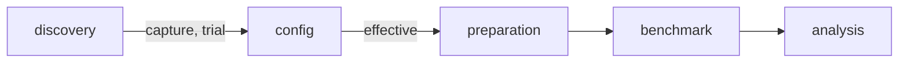

# Benchmark for Android crypto primitives

[](https://github.com/JuneKim0007/cryptobenchmark/actions/workflows/jca-contract.yml)
[](https://github.com/JuneKim0007/cryptobenchmark/actions/workflows/modules.yml)
[](https://github.com/JuneKim0007/cryptobenchmark/actions/workflows/docs.yml)

Measures the JCA cryptographic primitives a JVM or an Android device provides: what is registered, what runs, and how fast.



## Setup

```
pip install -r requirements.txt
```

## First run

```
cp settings.example.yaml settings.yaml
cp apps/perf-repair/perfrepair.example.yaml apps/perf-repair/perfrepair.yaml   # set apps.targets
python3 apps/cli/facade.py --settings settings.yaml --check           # the resolved tree; no app build, device or model
python3 apps/cli/facade.py --settings settings.yaml                   # benchmark, then guided repair
```

| read | for |
|---|---|
| [docs/facade.md](docs/facade.md) | the settings index, its direction rule, the phases |
| [docs/run.md](docs/run.md) | prerequisites, `apps/benchmark-runner/pipeline.py` flags, `apps/benchmark-runner/demo.sh`, device runs |
| [docs/architecture.md](docs/architecture.md) | modules, dependencies, stage files |
| [docs/results.md](docs/results.md) | `results/<device_id>/` layout and `manifest.yaml` |
| [docs/cryptography/index.md](docs/cryptography/index.md) | configured primitives and providers |
| [docs/index.md](docs/index.md) | every cross-module doc |
| [apps/perf-repair/README.md](apps/perf-repair/README.md) | crypto replacements worth testing in an app |

## Limitations

- AOT is assumed: the benchmark app, and every provider bundled in it, is compiled ahead of time (`speed`) before measuring. Real apps start JIT- or profile-compiled, so first calls in a real app can be slower than the numbers here.
- Only a controlled core environment is assumed: the measuring thread is pinned and samples are taken in steady state. A real app's thread moves between core types under the scheduler, which is hard to predict, so its timings can spread wider than reported.
- Garbage is collected between samples, outside the timer, so each sample is measured in a controlled, stabilised setting; a real app pays that collection cost inside its own work.
