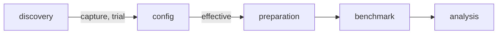

# Benchmark for Android crypto primitives

[](https://github.com/JuneKim0007/cryptobenchmark/actions/workflows/jca-contract.yml)
[](https://github.com/JuneKim0007/cryptobenchmark/actions/workflows/modules.yml)

Measures the JCA cryptographic primitives an Android device actually provides — what is registered,
what really runs, and how fast.

## How it works



| Module | Does |
|---|---|
| `:environment:discovery` | lists every provider and service the device registers, and calls each once to see what runs |
| `:config` | crosses what the device runs with the authored `config/` into `effective.yaml`, the one file a run reads |
| `:preparation` | turns `effective.yaml` into cases — keys, inputs, parameters — and calls each once before any timer |
| `:benchmark` | refuses a plan this device cannot run, then times each case; Jetpack Microbenchmark on the device |

Modules talk only through YAML files; each is built and tested alone against its own `example/`
files (`tools/module-isolation`). One exception: `:benchmark` is built with `:preparation`,
because it times the call preparation builds.

## Scope

AES, ChaCha20, RSA, SHA-2, HMAC, ECDSA and their key generation, on Pixel 9 and Pixel 10.
Catalogue: [primitives](docs/cryptography/primitives.md), [providers](docs/cryptography/providers.md).

## Run

```
python3 scripts/pipeline.py              # discover and configure, on the host
python3 scripts/pipeline.py --bench      # and prepare, measure, analyse (JVM stand-in until #33)
python3 scripts/pipeline.py --device     # the same on the attached device, over adb
scripts/demo.sh --fast                   # the whole host flow on three primitives, about 9s
```

What to measure: `config/global.yaml` and `config/testsets/`. Output: `results/`, indexed by
`results/manifest.yaml`. Requires Java 17; the Gradle plugin fetches Kotlin.

`--device` needs `ANDROID_HOME` (default `~/Library/Android/sdk`) and a device whose adbd can run as
root: the app writes its files mode 660, so only root can pull them. androidx.benchmark refuses to
measure on an emulator (`EMULATOR`) or, on a rooted device, with CPU clocks not locked (`UNLOCKED`);
`--suppress-errors EMULATOR,UNLOCKED` lets it, and the numbers are then not comparable to a locked
device's. It supersedes `android-run/run.sh`.

Energy: set `harness.energy.capture` to `measured` (joules over Jetpack's own timed phase, beside `timeNs`)
or `dry` (an energy-only loop) in `global.yaml` or a test-set override; `config/global-energy.yaml` is an
example. The run probes the rails first and refuses energy where they are absent or ignore load; joules
need a device with ODPM rails (Pixel 6 and later). The analysis needs `pip install -r
tools/energy/requirements.txt` (pass that interpreter with `--energy-python`). Details:
[measure.md](modules/benchmark/docs/measure.md#energy).

## Docs

File structure, language and dependency rules: [docs/docs.md](docs/docs.md). Each module's README
lists its files; its `docs/` explains how it works.
