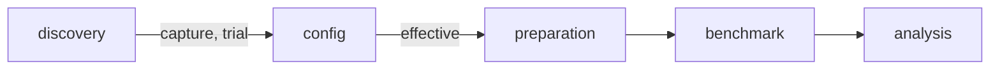

# Benchmark for Android crypto primitives

[](https://github.com/JuneKim0007/cryptobenchmark/actions/workflows/jca-contract.yml)
[](https://github.com/JuneKim0007/cryptobenchmark/actions/workflows/modules.yml)
[](https://github.com/JuneKim0007/cryptobenchmark/actions/workflows/docs.yml)

Measures the JCA cryptographic primitives a JVM or an Android device provides: what is registered, what runs, and how fast.



## Setup

```
pip install -r requirements.txt
```

## First run

```
cp settings.example.yaml settings.yaml
cp apps/perf-repair/perfrepair.example.yaml apps/perf-repair/perfrepair.yaml   # set apps.targets
python3 apps/cli/facade.py --settings settings.yaml --check           # the resolved tree; no app build, device or model
python3 apps/cli/facade.py --settings settings.yaml                   # benchmark, then guided repair
```

| read | for |
|---|---|
| [docs/facade.md](docs/facade.md) | the settings index, its direction rule, the phases |
| [docs/run.md](docs/run.md) | prerequisites, `apps/benchmark-runner/pipeline.py` flags, `apps/benchmark-runner/demo.sh`, device runs |
| [docs/architecture.md](docs/architecture.md) | modules, dependencies, stage files |
| [docs/results.md](docs/results.md) | `results/<device_id>/` layout and `manifest.yaml` |
| [docs/cryptography/index.md](docs/cryptography/index.md) | configured primitives and providers |
| [docs/index.md](docs/index.md) | every cross-module doc |
| [apps/perf-repair/README.md](apps/perf-repair/README.md) | crypto replacements worth testing in an app |

## Recommended settings

- **Set `run.thermalGate` on a phone.** A phone's power controller can lower the CPU speed while the CPU still reports as locked, so numbers shift with no error or status change. On a Pixel 10 the fastest core drops from 3.78 to 3.40 GHz at a skin temperature near 36 °C. The gate starts a run only below a limit, discards a run that ends too hot, and moves the start limit by itself as the session heats up.
- **Find `temperatureKeptCelsius` for each device.** Only the start limit adapts. The kept temperature is a property of the device, and 36.0 was measured on a Pixel 10 only.
- **Give very short algorithms more runs.** A case contains runs and a run contains iters. Fast hashes and MACs vary more from run to run than slow operations do, and more iters do not fix that: the extra launches do. `run.processRepetitions` sets one count for every case.
- **Use airplane mode and `run.isolation: case`.** Background radio work adds noise, and the gate needs one launch per case.

## Fixed behavior

These are not settings.

- GC stays on; a full collection is forced between iters with the timer stopped, so one rarely lands inside an iter, and the pause is reported beside the time.
- The app and every bundled provider are compiled ahead of time (`speed`) before measuring.
- Energy is always measured in its own pass, traced and without forced collections; timing is never traced.
- A process prepares only the case it runs, so another case's keys or failures can't affect it.
- A launch whose warm-up left unusably short iters is measured once more, then recorded as failed.

## Assumptions

- AOT: real apps start JIT- or profile-compiled, so their first calls can be slower than these numbers.
- Garbage collection: a real app pays for collection inside its own work; this cost is reported beside the number, not in it.
- CPU: the measuring thread stays on one big core; a real app's thread moves between core types.
- Clocks: on an unrooted phone clocks can't be locked, so numbers assume the governor holds the core at full speed.
- Temperature: the phone is assumed not to be throttling; temperature is recorded for each case, and held to a limit only with `run.thermalGate`.
- Keys: each launch generates its own key, so key-dependent algorithms (RSA, ECDSA) also vary from key to key.
