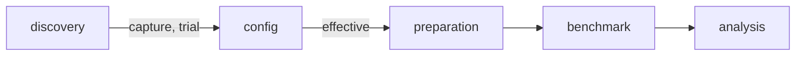

# Benchmark for Android crypto primitives

[](https://github.com/JuneKim0007/cryptobenchmark/actions/workflows/jca-contract.yml)
[](https://github.com/JuneKim0007/cryptobenchmark/actions/workflows/modules.yml)
[](https://github.com/JuneKim0007/cryptobenchmark/actions/workflows/docs.yml)

Measures the JCA cryptographic primitives a JVM or an Android device provides: what is registered, what runs, and how fast.



## Setup

```
pip install -r requirements.txt
```

## First run

```
cp settings.example.yaml settings.yaml
cp perf-repair/perfrepair.example.yaml perf-repair/perfrepair.yaml   # set apps.targets
python3 scripts/facade.py --settings settings.yaml --check           # the resolved tree; no app build, device or model
python3 scripts/facade.py --settings settings.yaml                   # benchmark, then guided repair
```

| read | for |
|---|---|
| [docs/facade.md](docs/facade.md) | the settings index, its direction rule, the phases |
| [docs/run.md](docs/run.md) | prerequisites, `scripts/pipeline.py` flags, `scripts/demo.sh`, device runs |
| [docs/architecture.md](docs/architecture.md) | modules, dependencies, stage files |
| [docs/results.md](docs/results.md) | `results/<device_id>/` layout and `manifest.yaml` |
| [docs/cryptography/index.md](docs/cryptography/index.md) | configured primitives and providers |
| [docs/index.md](docs/index.md) | every cross-module doc |
| [perf-repair/README.md](perf-repair/README.md) | crypto replacements worth testing in an app |
