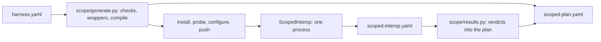

# scoped

Interop check of app functions from perf-repair's `harness.yaml`, original against patched, on the device; nothing is timed. Run flags: `docs/run.md`. File map: [index.md](index.md).

## Diagram



## Run

```
python3 apps/benchmark-runner/pipeline.py --device --harness <harness.yaml>
```

| step | rule |
|---|---|
| output | `checked/` beside `harness.yaml`; `--results` is refused |
| device | a `manifest.yaml` one folder above the harness's names the device it was built for; another attached device stops with `harness_other_device` |
| generate | `checked/scoped/scoped-plan.yaml`; sources in package `io.github.junekim0007.cryptobench.scoped` under `src/androidTest/java/`, git-ignored |
| compile | all scopes in one Gradle compile; on failure, each scope alone, then the passing set together |
| no scope compiled | the empty catalog is written and the run fails `nothing_to_check` |
| a compile error outside the generated folder | fails `harness_build_failed` |
| passing scopes compile alone, not together | fails `scopes_conflict` |
| cleanup | generated sources are removed after the run, on success and on failure |
| failed run's plan | a run that fails after generate copies its `scoped-plan.yaml` to `checked/scoped-plan.failed.yaml`, the file its failure line names; the next run removes it |
| last run kept | the previous `scoped/` is set aside as `scoped.previous/` and restored when the new run fails or is interrupted; dropped once the new manifest is written; a `scoped.previous/` a killed run left comes back first |
| other runs | never run `ScopedInterop`: it runs only by class name |
| interop check | `ScopedInterop`, one process: installs the bundled providers, calls each variant, writes `scoped-interop.yaml` |
| bundled providers | the `ScopedInterop` process installs `effective.yaml`'s `bundledProviders` first |

`python3 apps/benchmark-runner/scope_generate.py <harness.yaml> <out>` runs generate and compile alone and leaves the sources in place.

## Wrappers

| item | value |
|---|---|
| package | `io.github.junekim0007.cryptobench.scoped.s<id>.before` and `.after` |
| Java | `public final class ScopeFunction`; the method becomes `public static ... throws Exception`, since a swap can add a checked exception; annotations dropped |
| Kotlin | `object ScopeFunction`; visibility, `override`, `open`, `final`, `inline`, `tailrec`, `external` dropped |
| catalog | `scoped.GeneratedScopes`, loaded by name through `ScopeCatalog`; absent: `missing_class` |
| imports | `imports` lines, terminated per language |

## Not compilable

| reason | when |
|---|---|
| `not_a_function`, `unparseable_signature` | the source is not one method or function |
| `suspend_function`, `operator_function`, `infix_function`, `extension_function`, `generic_function`, `vararg_parameter` | unsupported shape |
| `signature_changed` | before and after differ in name, parameters or return type |
| `unsupported_parameter: <name>: <type>` | a parameter outside the input table, `Context` included |
| `missing_input: inputSize` or `keySize`, `none from <app\|run>` | the input the parameter needs is null in `harness.yaml` |
| `no_key_algorithm` | a key parameter and an `option` not in `Type\|name\|provider` form |
| `unsatisfied_dependencies` with `identifiers` | a dependency not imported, not language-provided, not stubbed |
| `compile_error` with `compilerErrors` | Gradle rejects the scope compiled alone |

## Inputs

Each side builds its own inputs (`b`/`a`-prefixed values in `GeneratedScopes`), so a function that changes its input in place never changes what the other side receives; a consumer's artifact comes from the before producer on that side's own inputs.

`harness.yaml` `schemaVersion: 6`; `inputs: {inputSize, keySize, from}`, `from` is `app` (the scope's static sizes) or `run` (the run's configured sizes); any other value is `invalid`. `scoped-plan.yaml` carries `inputs` with `from`.

| parameter type | value |
|---|---|
| `byte[]`, `ByteArray` | `inputSize` random bytes, seed 7 |
| `String`, `CharSequence` | `inputSize` alphanumeric characters, seed 7 |
| `char[]`, `CharArray` | same characters as an array |
| `SecretKey`, `Key`, `SecretKeySpec` | `SecretKeySpec` of `keySize / 8` random bytes, seed 8; algorithm = the option's name up to `/` |
| `PrivateKey`, `PublicKey`, `KeyPair` | `ScopeKeys`: the key planner's pair for the option's item at `keySize`, generated once per run and kept in `scope-keys/` on the device, every process has the same bytes, each side decodes them through its own provider: before `current`'s, after `option`'s (another provider's key class is converted at every init); a key that cannot be built is that scope's `call_failed` |
| `File` | a new temp file of `inputSize` random bytes, seed 7, per call |
| `boolean`, `byte`, `short`, `int`, `long`, `float`, `double`, `char`, in Java or Kotlin spelling | one fixed value: `true`, `1`, `1L`, `1f`, `1.0`, `'a'`; nothing says what the function does with it, so a function that fails or takes a short path on it is `call_failed` or dilutes the ratio |

## Dependencies

| class | rule |
|---|---|
| imported | the simple name or alias of an `imports` line |
| language-provided | a fixed `java.lang` set; Kotlin adds a fixed default-import set |
| stub | `TAG` only: a string constant |
| deferred | unresolved with a wildcard import: left to the compiler, listed as `deferredToCompiler` |

## Interop check

| check | chosen when | passes when |
|---|---|---|
| `round_trip` | a scope whose `inverse` is `produce` and its partner (an `inverse` link of perf-repair's `units.json`, never a name), the consumer takes exactly one parameter of the producer's return type, the producer exactly one of the consumer's | before-produce then after-consume, and after-produce then before-consume, restore the input; when either is an `upgrade`, each side runs its own produce and consume |
| `output_changes` | an `upgrade` scope (it replaces a broken algorithm) with no round-trip partner | never checked: its output differs by definition |
| `same_output` | a function with a value | two calls of before agree and after equals before |
| `none` | void or `Unit` | never checked |

| verdict | plan status `checked` | when |
|---|---|---|
| `passed` | yes | the check passed |
| `unchecked` | yes | `none`, `output_changes`, `no_output`, or `nondeterministic_output` (a randomized primitive with no partner) |
| `not_comparable` | no | `identity_only_output`: before returned an object with no value equality (`equals` from `Object`, or a primitive array other than bytes and chars), so two calls cannot be compared |
| `interop_failed` | no | the check failed; reason names the direction or `outputs_differ` |
| `call_failed` | no | a variant threw on its inputs |

## Outputs

| file | holds |
|---|---|
| `scoped-plan.yaml` | `schemaVersion: 1`, `app`, `harness`, `seed`; per scope: `id`, `function`, `language`, `current`, `option`, `inputs`, `status`, `reason`, `interop` (`check`, its partner and role, `result`, `reason`); `identifiers`, `compilerErrors`, `deferredToCompiler` when they apply |
| `scoped-interop.yaml` | `"<id>": {interop, check, reason}` from the device |

- `current` is the app's item before the swap, carried from `harness.yaml`.

| status | meaning |
|---|---|
| `not_measurable` | `notMeasurable` in `harness.yaml` (`no_operation`): recorded with `reason`, never generated |
| `compiled` | generated; replaced after the device run |
| `checked` | interop `passed` or `unchecked` |
| `not_compilable`, `not_comparable`, `interop_failed`, `call_failed` | excluded with `reason` |
