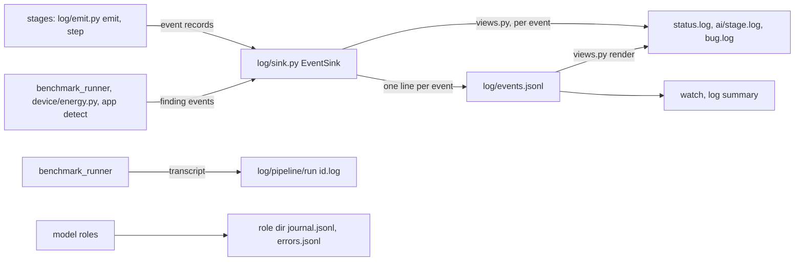

# Run log

## Diagram

## Files

Every command appends to `<device>/log/`, except `details/primitives_missing.yaml` and `details/benchmark_coverage.yaml`, rewritten whole; nothing in it is read back by a stage.

| file | holds |
|---|---|
| `events.jsonl` | one JSON line per event, every field on every line (`dto/event.py`, schema 1); the only stream commands write |
| `status.log` | one line per outcome a person acts on, a `run` header and `end` line per run |
| `ai/screening.log`, `ai/classify.log`, `ai/grouping.log`, `ai/supervisor.log`, `ai/worthiness.log`, `ai/replace.log` | one model stage's events, one line each, problems indented; `classify` is screening's classify role, `supervisor` grouping's review role |
| `bug.log` | each exception that is not a coded error, with its traceback |
| `pipeline/<run id>.log` | the cryptobenchmark transcript of every `pipeline.py` call of one run, each headed `# <stage>[ app <app>]` and `$ <command>` |
| `details/primitives_missing.yaml` | the primitives and providers an app uses that this guide run skipped or stopped on because they are not available ([below](#primitives-missing)) |
| `details/benchmark_coverage.yaml` | the benchmark gate's last check (schema 1): `run`, `point` (`used`, `grouped`), `attempts` (per point the deltas run, at most 1), `totals` (used items, items and keys measured, per gap class), `items` (per used item `measured` or its first gap class), `gaps` (item, operation, variant, key and input size, metric, class, `action` `delta` or `coded`, reason, case), `deltas` (this run's: session, cases added, anchor cases, setup fields that differ, drifted anchors) ([used-set.md](used-set.md#benchmark-gate)) |

- `status.log`, `ai/*.log` and `bug.log` are views: each line is a function of one event (`log/views.py`); `render()` recomputes them from `events.jsonl`.
- `pipeline/<run id>.log`, `details/*.yaml` and the role journals are no views; an event's `ref` points into them.
- `log/screening/ai.log` and `log/grouping/ai.log` are no longer written: their lines are in `ai/classify.log`, `ai/grouping.log` and `ai/supervisor.log`; a folder written before keeps the old files, and `render()` over its `events.jsonl` gives the new ones.
- `<results root>/pipeline.log` is no longer written; the transcript is in the device folder, one file per run.

## Status lines

Each line starts with a code word, then what it is about, then `: <detail>`; `log/status.py` renders one function per line kind. The pointer line alone starts with `##`.

| event | line |
|---|---|
| `run_start`, `run_end` | `run <run id> <ts>: <command>`; `end <run id>: <exit> (<s>)` |
| `finding` from `terminate` ([stops.md](stops.md)) | `<code> <subject>: [<action>: ]<detail>[; see <ref>]; next: <next step>`; the subject is the item (and `app <app>`), else `app <app> at <step>` or `guide <step>` for the guide, else `<stage> <step>`; the action is shown when it is `warn` or `skip` |
| guide `target` end | `ok`, `reused` or `not_run app <app>[: <detail>]`; a stopped app has its `terminate` or `bug` line only |
| device stage end | `ran` or `reused device <stage>: <reason>`; `failed device <stage>: <error>` for a failure no `terminate` reported |
| `error`, `bug` | `<code> error: <detail>`; `bug <stage> <step>: <type>: <message>; traceback in log/bug.log` |
| `finding` with `data.pointer` | its detail, `## to check primitives skipped or stopped due to not downloading them go <path>` |

| code | emitted by | item, detail |
|---|---|---|
| `not_on_device` | `perfrepair.app`, after its files are written | the provider; its sites |
| `energy_invalid` | `device/energy.py`, after each device run | the case id; its reasons across process files (`short_window`, `window_uncovered`, ...); ref: the `energy.json` |
| `energy_unreadable` | `device/energy.py` | the manifest; the run stands |
| `pipeline_failed` | `benchmark_runner.py` | the stage; exit and last error line; ref: `pipeline/<run id>.log:<line>` of the call; the device step, the guide step and the app's target add no line |
| `perf_mode_unmeasured`, `perf_mode_maybe_unmeasured`, `run_metrics_overridden` | `device/measures.py` | the metrics |
| `missing_dependency` | `benchmark_runner.py` | the module and its install line |
| `bundled_missing` | `device/bundled.py` | each provider with its coordinates and apps |
| a guide stop (`no_options`, `missing_device_stage`, `<step>_failed`, ...) | `guide/state.py`, `guide/run.py` | `<step>_failed` carries the inner code in `data.inner` and first in its detail |

- The code is `data.code`; an event written before it has its detail's first word holding an underscore, or one word before a colon.
- A step that ends in a `Halt` records `data.code` and `data.reported`; its own line is left out.
- A line adds the last `error` line of its detail.

## Primitives missing

`<device>/log/details/primitives_missing.yaml`, schema 1: `schemaVersion`, `run` (the run id), `missing` (a list of rows). Only `device/primitives_missing.py` writes it, atomically, and whole on every change, so a killed run leaves what it knew. It holds an empty list from the moment the guide has the device folder, so a clean run leaves no stale file.

| field | holds |
|---|---|
| `primitive` | `<engine type> <algorithm>`; null on a provider's row |
| `provider` | the provider's name; null when the site names none |
| `reason` | below |
| `apps`, `sites` | the apps that use it, and their sites; a provider only an app's build ships has 0 sites |
| `action` | `skipped` or `stopped`, what the setting did |
| `coordinates` | the `group:name:version` that ships it, when known |
| `next` | what to do about this row |

| reason | where (`device/missing_rows.py` reads it) | action from |
|---|---|---|
| `not_on_device` | a site's provider, or the service it needs, is not on the device (`sites.json`; the `not_on_device` finding) | `stops.not_on_device` |
| `absent_on_device` | the same resolution, but no site names a provider and the app ships none: the app step only prints it | always `skipped` |
| `bundled_missing` | a provider the apps ship or name that the device lacks and no applied row covers; `next` carries the catalog's reason | `stops.bundled_missing` |
| `host_cannot_build` | as `bundled_missing`, on a host run, for a provider `fromApps apply` matched or the base's `providers.bundled` lists | `stops.bundled_missing` |
| `not_screened` | the benchmark measured it and `screen.json` has no verdict (`primitive_not_screened`); every name, not the first | always `stopped` |
| `not_measured` | a site's item the run log has as `skipped`, `unmeasured` or `not_runnable`, with no measured case | always `skipped` |
| `no_device_item` | a site that resolved on a device provider, whose item `grouping/items.json` does not hold | always `skipped` |
| `variant_not_measured` | a scope whose primitive was measured only in the other benchmark variant (`dossiers.json` `noOptions`) | always `skipped` |
| `not_benchmarked` | a used item with a gap in the benchmark gate's check, `next` its class and reason | `skipped` for a coded gap, else `stopped` |

- The guide holds the rows in memory: no stage reads this file back, so the rule of this folder stands.
- `## to check primitives skipped or stopped due to not downloading them go <path>` is one `finding` event, emitted with the run's first row, so `status.log` has it once per run, among the findings it points from; none with an empty list.
- The guide prints the same line once, last of all it prints, whether it stopped or finished, when the list is not empty.
- A standalone `perfrepair.app` writes no list: only the guide runs every source.

## Event fields

| field | holds |
|---|---|
| `ts`, `run` | UTC time to the millisecond; the id of the command's run, shared by commands it calls in-process |
| `stage`, `step`, `item`, `app` | where: `device`, `inbound`, `grouping`, `screening`, `app`, `repair`, `replace`, `worthiness`, `report`, `guide`, `run`, or a logger's package for a log record |
| `kind`, `event` | `static` or `model`; `start`, `end`, `turn`, `decision`, `run_start`, `run_end`, `error`, `bug`, `finding`, `log` |
| `outcome`, `durationMs`, `detail` | `ok`, `ran`, `reused`, `failed`, `accepted`, `rejected`, `refused`, `decided`, `dropped`, a finding's code, a log level, a run's exit; time; a reason or message |
| `tokens`, `costUsd` | a turn's usage from the reply: `input`, `output`, `cacheRead`, `cacheWrite`; the CLI's `total_cost_usd`, null from the API and dry-run gateways |
| `ref` | `<role dir>/journal.jsonl:<line>` for a turn, the outbox record for a decision, the file a finding names, relative to the device folder |
| `data` | `counts` and `files` (path → sha256) of a step's end; `session`, `turn`, `problems`, `outbox` of a model event; a start's `pending` and outbox `opened`, `resumed` or `rotated` |

## Rules

- A static step emits `start` and `end`; a model step emits `start`, a `turn` per model call, a `decision` per committed item, `end`.
- No prompt or reply text is in an event; the journal line and the outbox record hold it.
- Records logged before the device folder is known are kept and written, in order, once it is; a command that never names an existing folder writes nothing.
- Each line is one append of a whole line; an append to a file a crash left mid-line writes a newline first, so the cut line stays its own line, and the sink adds one `append_repaired` finding (the journal one through `terminate`).
- Every reader of a JSON-lines file goes through `files.read_jsonl`: whole lines only; a line that is a prefix of JSON, cut by a crash, is skipped; any other line that does not parse is refused; the validator reports a partial last line.
- Records past the 10000 kept before the device folder is known are counted, one `log_dropped` finding when the folder is bound; a `data` value of a shape JSON cannot write is written as text.
- The stderr lines are the same as without the log: event records stay off stderr, and setting lines at DEBUG reach only `events.jsonl`.
- A `Halt` is its `terminate` finding and `error <code>: ...` on stderr; another coded error is one `error` event with `data.code` and the same stderr line, none when its command runs inside another; any other exception is a `bug` event, `error bug: <type>: <message>; traceback in <device>/log/bug.log`, exit 1; before the folder is known the traceback goes to stderr.
- `watch` prints one line per finished step, a finding's status line, and a counter per model step, `grouping assign 37/176 · 2 rejected · $0.0040 · 41s`, rewritten in place on a terminal with each turn, one line per decision elsewhere; it exits 0 when the last line it read is a `run_end`, 130 on Ctrl-C; without `--from-start` it starts at the file's end; with it, every run in the file replays, each `run_start` resetting the counters.
- `log summary` takes every run of the folder unless `--run` names one or `--last` asks for the newest: a line per run (a run with no end is `running` if newest, else `unfinished`), the total, then per stage and per app folder its time (the sum of its step ends, plus the turns of a model step a killed run left open; an app folder leaves out the guide's steps), each static step's runs and time, items and decisions, model calls, rejections and their top problems, the slowest items, tokens and cost; last `status:`, the status lines of the runs shown (`status` in `--json`).
