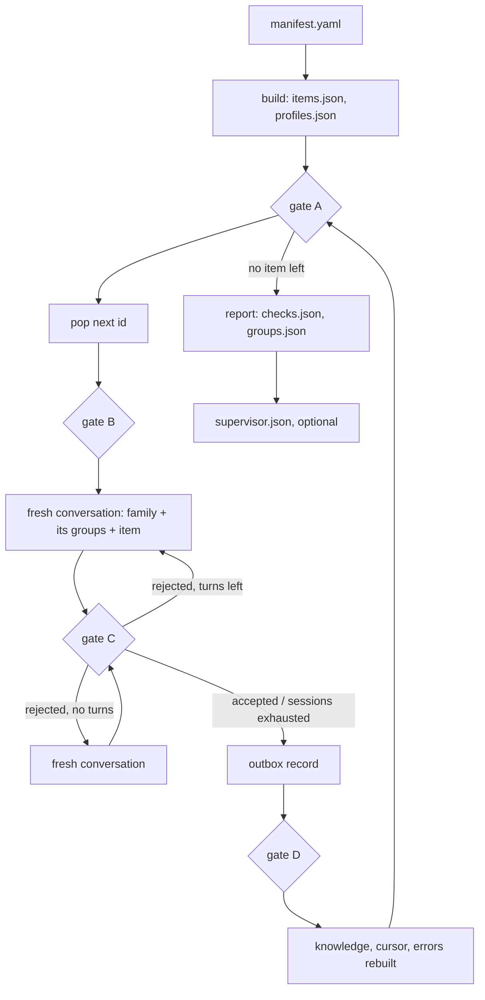

# Grouping

## Diagram

## Files (`<run>/grouping/`)

| File | Written by | Holds |
|---|---|---|
| `items.json` | build | `{id, type, name, provider, family, resolved, group: null}` per item |
| `profiles.json` | build | per id: keyKind and its rule, instantiates, runs, reason, default key size, key algorithm and provider, bare name, measured, prepared key sizes |
| `outbox/NNNNNN.json` | assign | one record per decided item: `assigned` with the answer, or `dropped` with every problem; the commit |
| `knowledge.json` | assign | projection of the outbox: groups `{family, description, members}`, dropped ids, version |
| `cursor.json` | assign | next id, assigned and dropped counts, knowledge version |
| `journal.jsonl` | assign | one line per turn: item, session, turn, status, problems, reply, message hash |
| `errors.jsonl` | assign | projection of dropped records: item, qualified name, problems |
| `checks.json` | report | static findings with severity |
| `groups.json` | report | families, groups with members, runnable members, common key sizes, findings; items index; dropped |
| `supervisor.json` | report --supervisor | per family: reviewed or failed, findings |
| `supervisor.journal.jsonl` | report --supervisor | one line per review turn |

## Answer contract

| Field | Meaning |
|---|---|
| `group` | an existing group of the item's family, or empty |
| `newGroup.id`, `newGroup.description` | a new group when `group` is empty; id `^[a-z0-9][a-z0-9.-]{1,39}$`, not a family id; description ≤ 400 characters |
| `amend[]` | `{group, description}`: groups of the same family |
| `reason` | non-empty |

## Gates

| Gate | When | Checks |
|---|---|---|
| A | before every pop | items and profiles valid; outbox contiguous; knowledge equals its replay |
| B | after pop | item parses whole, carries no group, family and profile exist |
| C | every answer | the answer contract above; the item is not already decided |
| D | after write | the record reads back equal; new knowledge validates |

## Retry

| Limit | Default | Flag |
|---|---|---|
| turns per conversation | 3 | `--turns` |
| conversations per item | 2 | `--sessions` |

A respawned conversation starts with no history of the failed one.

## Families (`catalog/families.yaml`)

| Family | Engine type | Key kind |
|---|---|---|
| `cipher.secret` | Cipher | secret |
| `cipher.pair` | Cipher | pair |
| `cipher.unknown` | Cipher | unknown |
| `signature.pair` | Signature | pair |
| `mac.secret` | Mac | secret |
| `digest.none` | MessageDigest | none |
| `keygen.none` | KeyGenerator | none |
| `keypairgen.none` | KeyPairGenerator | none |
| `agreement.peer` | KeyAgreement | peer |

## Static findings

| Kind | Severity |
|---|---|
| `resolved_parameters_differ` | error |
| `dropped` | error |
| `no_common_key_size` | warning |
| `no_runnable_member` | warning |
| `singleton` | info |

## Emulator capture, 2026-10-05

| Count | Value |
|---|---|
| items | 168 (96 runnable) |
| key kind by rule | measured 32, engine type 83, key generator 25, declared 7, unknown 21 |
| system prompt | 2.7K characters |
| item message, every item its own group | ≤ 4.4K characters, median 2.3K |
