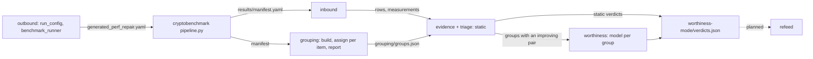

# Pipeline

## Diagram

## Stages

| Stage | Command | Reads | Writes | Model |
|---|---|---|---|---|
| outbound | `data_handler.outbound` (library) | base `global.yaml` | `generated_perf_repair.yaml`, benchmark `results/` | no |
| inbound | `python3 -m perfrepair.data_handler.inbound --manifest <m> -o <run>` | `manifest.yaml` and its files | `rows.json`, `measurements.json`, `run_log.json`, `sites.json` | no |
| grouping | `python3 -m perfrepair.grouping build\|assign\|report --run <run>` | `manifest.yaml` and its files | `grouping/` (`docs/grouping.md`) | one conversation per item, up to turns × sessions; optional supervisor per family |
| worthiness | `python3 -m perfrepair.orchestrate worthiness --run <run> --mode latency\|battery` | `rows.json`, `measurements.json`, `grouping/groups.json` | `worthiness-<mode>/` (evidence.json, outbox/, verdicts.json, journal.jsonl, errors.jsonl) | one call per group with an improving pair |
| validate | `python3 -m perfrepair.validation <run>` | every artifact present | nothing | no |

- Every command accepts `--agent dry-run` in place of a model.
- A stage stops on a failed validation gate before it writes.
- A stage rerun resumes after the last outbox record.

## Emulator run, 2026-10-05

| Count | Value |
|---|---|
| rows | 163 |
| grouping items (calls, one conversation each) | 168 (96 runnable) |
| groups with same-name joins | 24, 8 with two providers |
| decided by triage | 16 `not_comparable` |
| worthiness calls per mode | 8 |
| worthiness message size | 1.3K–2.1K characters |
