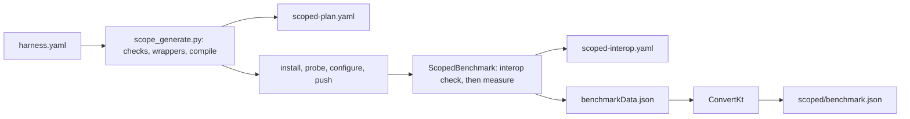

# scoped

Before/after measurement of app functions from perf-repair's `harness.yaml`. Run flags: `docs/run.md`. File map: [index.md](index.md).

## Diagram



## Run

```
python3 scripts/pipeline.py --device --harness <harness.yaml>
```

| step | rule |
|---|---|
| output | `measured/` beside `harness.yaml`; `--results` is refused |
| device | a `manifest.yaml` one folder above the harness's names the device it was built for; another attached device stops with `harness_other_device` |
| generate | `measured/scoped/scoped-plan.yaml`; sources in package `io.github.junekim0007.cryptobench.scoped` under `src/androidTest/java/`, git-ignored |
| compile | all scopes in one Gradle compile; on failure, each scope alone, then the passing set together |
| no scope compiled | fails `no_scope_compiled` |
| a compile error outside the generated folder | fails `harness_build_failed` |
| passing scopes compile alone, not together | fails `scopes_conflict` |
| settings | `run.harness` of the pushed `effective.yaml`; provider and entry overrides do not apply |
| energy capture | `none` and `measured`; `dry` fails `not_supported` |
| cleanup | generated sources are removed after the run, on success and on failure |
| normal runs | unchanged; `ScopedBenchmark` runs only by class name |

`python3 scripts/scope_generate.py <harness.yaml> <out>` runs generate and compile alone and leaves the sources in place.

## Wrappers

| item | value |
|---|---|
| package | `io.github.junekim0007.cryptobench.scoped.s<id>.before` and `.after` |
| Java | `public final class ScopeFunction`; the method becomes `public static`; annotations dropped |
| Kotlin | `object ScopeFunction`; visibility, `override`, `open`, `final`, `inline` dropped |
| catalog | `scoped.GeneratedScopes`, loaded by name through `ScopeCatalog`; absent: `missing_class` |
| imports | `imports` lines, terminated per language |

## Not compilable

| reason | when |
|---|---|
| `not_a_function`, `unparseable_signature` | the source is not one method or function |
| `suspend_function`, `operator_function`, `infix_function`, `extension_function`, `generic_function`, `vararg_parameter` | unsupported shape |
| `signature_changed` | before and after differ in name, parameters or return type |
| `unsupported_parameter: <name>: <type>` | a parameter outside the input table, `Context` included |
| `missing_input: inputSize` or `keySize`, `none from <app\|run>` | the input the parameter needs is null in `harness.yaml` |
| `no_key_algorithm` | a key parameter and an `option` not in `Type\|name\|provider` form |
| `unsatisfied_dependencies` with `identifiers` | a dependency not imported, not language-provided, not stubbed |
| `compile_error` with `compilerErrors` | Gradle rejects the scope compiled alone |

## Inputs

`harness.yaml` `schemaVersion: 4`; `inputs: {inputSize, keySize, from}`, `from` is `app` (the scope's static sizes) or `run` (the run's configured sizes); any other value is `invalid`. `scoped-plan.yaml` carries `inputs` with `from`; `prepared.yaml` takes only the sizes.

| parameter type | value |
|---|---|
| `byte[]`, `ByteArray` | `inputSize` random bytes, seed 7 |
| `String`, `CharSequence` | `inputSize` alphanumeric characters, seed 7 |
| `char[]`, `CharArray` | same characters as an array |
| `SecretKey`, `Key`, `SecretKeySpec` | `SecretKeySpec` of `keySize / 8` random bytes, seed 8; algorithm = the option's name up to `/` |

## Dependencies

| class | rule |
|---|---|
| imported | the simple name or alias of an `imports` line |
| language-provided | a fixed `java.lang` set; Kotlin adds a fixed default-import set |
| stub | `TAG` only: a string constant |
| deferred | unresolved with a wildcard import: left to the compiler, listed as `deferredToCompiler` |

## Interop check

| check | chosen when | passes when |
|---|---|---|
| `round_trip` | a scope whose `inverse` is `produce` and its partner (an `inverse` link of perf-repair's `units.json`, never a name), the consumer takes exactly one parameter of the producer's return type, the producer exactly one of the consumer's | before-produce then after-consume, and after-produce then before-consume, restore the input |
| `same_output` | a function with a value | two calls of before agree and after equals before |
| `none` | void or `Unit` | never checked |

| verdict | measured | when |
|---|---|---|
| `passed` | yes | the check passed |
| `unchecked` | yes | `none`, `no_output`, or `nondeterministic_output` (a randomized primitive with no partner); the report counts it in `measuredUnchecked` and says it is measured without an interop check |
| `not_comparable` | no | `identity_only_output`: before returned an object with no value equality (`equals` from `Object`, or a primitive array other than bytes and chars), so two calls cannot be compared |
| `interop_failed` | no | the check failed; reason names the direction or `outputs_differ` |
| `call_failed` | no | a variant threw on its inputs |

A consumer scope is measured on the before producer's output.

## Outputs

| file | holds |
|---|---|
| `scoped-plan.yaml` | per scope: `id`, `function`, `language`, `current`, `option`, `inputs`, `metrics`, `status`, `reason`, `interop`, `cases` |
| `scoped-interop.yaml` | `"<id>": {interop, check, reason}` from the device |
| `prepared.yaml` | measured cases: `type: Scope`, `algorithm` = function, `provider` = app, `operation` = `before` or `after` |
| `benchmark.json` | the cases' shape; ids `scope:<id>:before`, `scope:<id>:after` |

- `current` is the app's item before the swap, carried from `harness.yaml` so the primitive interop oracle can check the `current` → `option` pair; no step here reads it yet.

| status | meaning |
|---|---|
| `not_measurable` | `notMeasurable` in `harness.yaml` (`no_operation`): recorded with `reason`, never generated |
| `compiled` | generated; replaced after the device run |
| `measured` | interop `passed` or `unchecked` |
| `not_compilable`, `not_comparable`, `interop_failed`, `call_failed` | excluded with `reason` |
