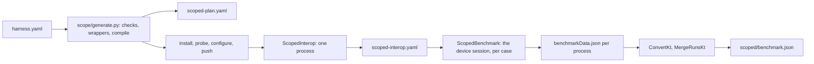

# scoped

Before/after measurement of app functions from perf-repair's `harness.yaml`. Run flags: `docs/run.md`. File map: [index.md](index.md).

## Diagram



## Run

```
python3 scripts/pipeline.py --device --harness <harness.yaml>
```

| step | rule |
|---|---|
| output | `measured/` beside `harness.yaml`; `--results` is refused |
| device | a `manifest.yaml` one folder above the harness's names the device it was built for; another attached device stops with `harness_other_device` |
| generate | `measured/scoped/scoped-plan.yaml`; sources in package `io.github.junekim0007.cryptobench.scoped` under `src/androidTest/java/`, git-ignored |
| compile | all scopes in one Gradle compile; on failure, each scope alone, then the passing set together |
| no scope compiled | the empty catalog is written and the call sites are measured alone; with no call site planned either, fails `nothing_to_measure` |
| a compile error outside the generated folder | fails `harness_build_failed` |
| passing scopes compile alone, not together | fails `scopes_conflict` |
| settings | `run.harness` of the pushed `effective.yaml`; provider and entry overrides do not apply |
| energy capture | `none` and `measured`; `dry` fails `not_supported` |
| cleanup | generated sources are removed after the run, on success and on failure |
| failed run's plan | a run that fails after generate copies its `scoped-plan.yaml` to `measured/scoped-plan.failed.yaml`, the file its failure line names; the next run removes it |
| last run kept | the previous `scoped/` is set aside as `scoped.previous/` and restored when the new run fails or is interrupted; dropped once the new manifest is written; a `scoped.previous/` a killed run left comes back first |
| normal runs | unchanged; `ScopedBenchmark` and `ScopedInterop` run only by class name |
| interop check | `ScopedInterop`, one process before any case: installs the bundled providers, calls each variant, writes `scoped-interop.yaml` |
| measuring | the device session of `docs/device-session.md`, as for the benchmark: `run.isolation`, a case's failure is one `case_failed` line, timeouts, force-stop, pin warnings, repetitions merged by `MergeRunsKt` |
| case selection | the host names the measured cases with `-e case <id>`, or one ordered comma list when one process runs them all; `ScopedBenchmark` measures nothing else |
| bundled providers | every `ScopedInterop` and `ScopedBenchmark` process installs `effective.yaml`'s `bundledProviders` first |

`python3 scripts/scope_generate.py <harness.yaml> <out>` runs generate and compile alone and leaves the sources in place.

## Order

Before and after are measured in `run.scopedRepetitions` processes each (default 3), never in a fixed order: odd repetitions run a scope's `before` then `after`, even ones `after` then `before` (AB BA AB).

| repetitions | positions (before, after) | linear drift |
|---|---|---|
| 3 (default) | 1, 4, 5 against 2, 3, 6 | one step of 6 left on `after`, about a sixth of what a fixed order leaves |
| 4 | 1, 4, 5, 8 against 2, 3, 6, 7 | cancels |

- With `isolation: case` the order is the host's: one process per side per repetition. With `isolation: run` the host names the cases in that order with one `-e case a,b,...` and `ScopedBenchmark` runs them as named.
- Each side builds its own inputs (`b`/`a`-prefixed values in `GeneratedScopes`), so a function that changes its input in place never changes what the other side receives; a consumer's artifact comes from the before producer on that side's own inputs.

## Call sites

Every swap is also measured as its call alone, so no swap goes unmeasured when its function does not compile or its call fails.

| step | rule |
|---|---|
| plan | `callSite` of `harness.yaml`: the record's block holds both sides' `type`, `algorithm`, `provider`, `keySize`, `inputSize`, or `not_measurable` with `no_call_site`, `no_operation`, `not_an_item`, `type_changed` |
| effective | `callsite-<n>.yaml`, the run's `effective.yaml` with one item, one operation, the scope's sizes and variant, phase `WARM`, `onFailure: skip`; scopes on one selection share it |
| prepare | `ScopedInterop`, through `Preparation`, the capture and the trial: `prepared` with the benchmark's case, else `not_prepared` with the reason and `skipped.yaml` beside it |
| measure | the function's session: warm-up, gate, a process per case, repetitions, AB BA per pair; the timed call is the benchmark's `Invocations.of(case).perIteration` |
| settings | `run.harness`, as for a function, so the two kinds of number are taken alike |

## Wrappers

| item | value |
|---|---|
| package | `io.github.junekim0007.cryptobench.scoped.s<id>.before` and `.after` |
| Java | `public final class ScopeFunction`; the method becomes `public static`; annotations dropped |
| Kotlin | `object ScopeFunction`; visibility, `override`, `open`, `final`, `inline` dropped |
| catalog | `scoped.GeneratedScopes`, loaded by name through `ScopeCatalog`; absent: `missing_class` |
| imports | `imports` lines, terminated per language |

## Not compilable

| reason | when |
|---|---|
| `not_a_function`, `unparseable_signature` | the source is not one method or function |
| `suspend_function`, `operator_function`, `infix_function`, `extension_function`, `generic_function`, `vararg_parameter` | unsupported shape |
| `signature_changed` | before and after differ in name, parameters or return type |
| `unsupported_parameter: <name>: <type>` | a parameter outside the input table, `Context` included |
| `missing_input: inputSize` or `keySize`, `none from <app\|run>` | the input the parameter needs is null in `harness.yaml` |
| `no_key_algorithm` | a key parameter and an `option` not in `Type\|name\|provider` form |
| `unsatisfied_dependencies` with `identifiers` | a dependency not imported, not language-provided, not stubbed |
| `compile_error` with `compilerErrors` | Gradle rejects the scope compiled alone |

## Inputs

`harness.yaml` `schemaVersion: 5`; `inputs: {inputSize, keySize, from}`, `from` is `app` (the scope's static sizes) or `run` (the run's configured sizes); any other value is `invalid`. `scoped-plan.yaml` carries `inputs` with `from`; `prepared.yaml` takes only the sizes.

| parameter type | value |
|---|---|
| `byte[]`, `ByteArray` | `inputSize` random bytes, seed 7 |
| `String`, `CharSequence` | `inputSize` alphanumeric characters, seed 7 |
| `char[]`, `CharArray` | same characters as an array |
| `SecretKey`, `Key`, `SecretKeySpec` | `SecretKeySpec` of `keySize / 8` random bytes, seed 8; algorithm = the option's name up to `/` |
| `PrivateKey`, `PublicKey`, `KeyPair` | `ScopeKeys`: the key planner's pair for the option's item at `keySize`, generated once and kept in `scope-keys/` on the device, so before, after and every process share it; a key that cannot be built is that scope's `call_failed` |
| `File` | a new temp file of `inputSize` random bytes, seed 7, per call |
| `boolean`, `byte`, `short`, `int`, `long`, `float`, `double`, `char`, in Java or Kotlin spelling | one fixed value: `true`, `1`, `1L`, `1f`, `1.0`, `'a'`; nothing says what the function does with it, so a function that fails or takes a short path on it is `call_failed` or dilutes the ratio |

## Dependencies

| class | rule |
|---|---|
| imported | the simple name or alias of an `imports` line |
| language-provided | a fixed `java.lang` set; Kotlin adds a fixed default-import set |
| stub | `TAG` only: a string constant |
| deferred | unresolved with a wildcard import: left to the compiler, listed as `deferredToCompiler` |

## Interop check

| check | chosen when | passes when |
|---|---|---|
| `round_trip` | a scope whose `inverse` is `produce` and its partner (an `inverse` link of perf-repair's `units.json`, never a name), the consumer takes exactly one parameter of the producer's return type, the producer exactly one of the consumer's | before-produce then after-consume, and after-produce then before-consume, restore the input |
| `same_output` | a function with a value | two calls of before agree and after equals before |
| `none` | void or `Unit` | never checked |

| verdict | measured | when |
|---|---|---|
| `passed` | yes | the check passed |
| `unchecked` | yes | `none`, `no_output`, or `nondeterministic_output` (a randomized primitive with no partner); the report counts it in `measuredUnchecked` and says it is measured without an interop check |
| `not_comparable` | no | `identity_only_output`: before returned an object with no value equality (`equals` from `Object`, or a primitive array other than bytes and chars), so two calls cannot be compared |
| `interop_failed` | no | the check failed; reason names the direction or `outputs_differ` |
| `call_failed` | no | a variant threw on its inputs |

A consumer scope is measured on the before producer's output.

## Outputs

| file | holds |
|---|---|
| `scoped-plan.yaml` | per scope: `id`, `function`, `language`, `current`, `option`, `inputs`, `metrics`, `status`, `reason`, `interop`, `cases`, `callSite` |
| `scoped-interop.yaml` | `"<id>": {interop, check, reason}` from the device |
| `prepared.yaml` | measured cases: `type: Scope`, `algorithm` = function, `provider` = app, `operation` = `before` or `after` |
| `benchmark.json` | the cases' shape; ids `scope:<id>:before`, `scope:<id>:after`; a call site's `scope:<id>:callSite:before`, `scope:<id>:callSite:after` |
| `callsite.yaml`, `callsite-<n>.yaml` | pushed: the call sites' cases, and one effective per distinct selection |
| `callsite-verdicts.yaml`, `callsite-<n>/prepared.yaml` | from the device: `"<case>": {status, folder, case, reason}`, and what each selection prepared |

- `current` is the app's item before the swap, carried from `harness.yaml` so the primitive interop oracle can check the `current` → `option` pair; no step here reads it yet.

| status | meaning |
|---|---|
| `not_measurable` | `notMeasurable` in `harness.yaml` (`no_operation`): recorded with `reason`, never generated |
| `compiled` | generated; replaced after the device run |
| `measured` | interop `passed` or `unchecked` |
| `not_compilable`, `not_comparable`, `interop_failed`, `call_failed` | excluded with `reason` |
