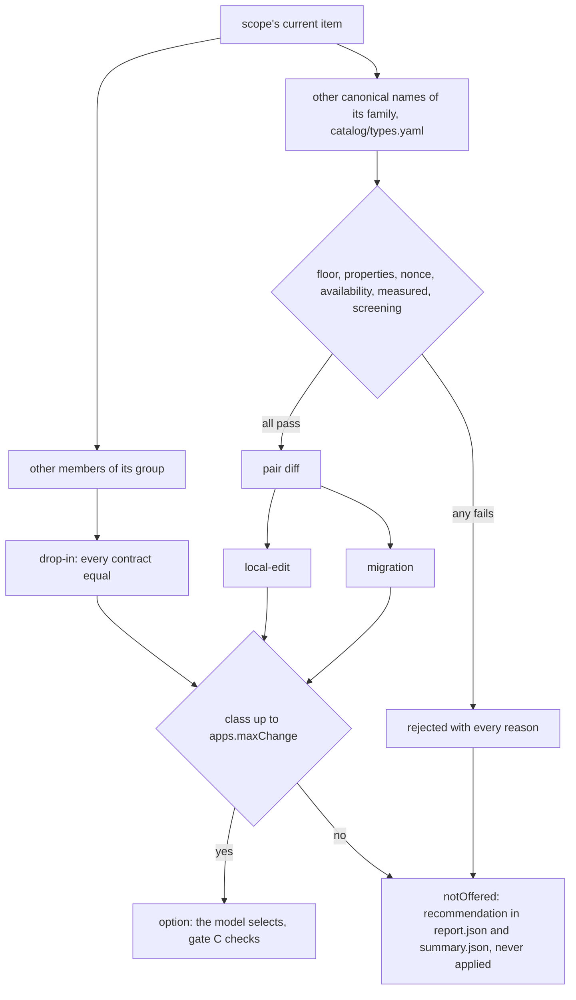

# Change classes

## Diagram

## Type

`catalog/types.yaml`, per family and canonical name, each fact sourced; `catalog/types.py` refuses the whole file on any bad row.

| Field | Values |
|---|---|
| `outputKind` | `digest`, `tag`, `ciphertext`, `aead_ciphertext`, `signature`, `shared_secret`, `secret_key`, `key_pair` |
| `authenticated`, `deterministic` | true, false |
| `nonceRequired` | `none`, `unpredictable` (a fresh random IV each call), `unique` (never repeated under one key) |
| `parameters` | the shape of the parameter object the call passes: `none`, `iv`, `gcm`, ... |
| `outputBytes` | bytes, null when it varies |
| `keyType` | the key the call takes, `none` without one |
| `strengthBits` | bits, `{key: <map>}` read at the key size, `{key, cap}` for the lower of the two, null unknown; SP 800-57 Part 1 r5 Tables 2 and 3 |
| `minSdk` | the first Android API level of the open-ended range on the reference page; null: check the device |

- Type is family + `outputKind` + properties; a model never decides it.

## Pair diff

| Field | Value | When |
|---|---|---|
| `input` | `same` | the parameter shape is equal |
| | `reshaped` | the shape differs and `parameters`' settled origin is `generated`, `literal` or `derived`, or the candidate takes none |
| | `new_parameter` | otherwise, and whenever the current call passes none |
| `key` | `same`, `size`, `type` | `keyType` equal and one key-size fact; another key-size fact; another `keyType` |
| `output` | `bytes` | same `outputKind`, other bytes or length |
| | `kind` | another `outputKind` |
| `reach` | `local`, `return`, `persist` | the sinks are all `local`; all `local` or `return`; any other sink, `unknown` included |
| `addsDependency` | true | the candidate's provider is one `providers.bundled` installed and the app does not ship |

`same` output is a drop-in's: a drop-in carries no diff.

## Classes

| Class | Holds when |
|---|---|
| `drop-in` | the candidate is another member of the current item's group |
| `migration` | `addsDependency`, `reach` `persist`, `key` `type`, `key` `size` with a key not generated in the function, `input` `new_parameter`, or `output` `kind` |
| `local-edit` | none of the above |
| `rejected` | any reason below |

| Reject reason | Holds when |
|---|---|
| `type_unknown` | no row for the current item or the candidate |
| `strength_below` | the candidate's strength at the scope's key size is below the current one's |
| `strength_unknown` | the two strength facts differ and either has no value at this key size |
| `authenticated_lost` | the current is authenticated, the candidate is not |
| `deterministic_lost` | the current is deterministic, the candidate is not, and the output kind is in `deterministicRelied` |
| `nonce_not_generated` | both need a nonce, the requirement differs, and `parameters`' settled origin is not `generated` |
| `unavailable` | the app's `minSdk` is below the candidate's and its provider is not bundled |
| `availability_unknown` | the candidate's `minSdk` is null, or above API 1 with the app's unread, and its provider is not bundled |
| `not_measured` | it does not run, its provider is absent, or `rows.json` has no line of it |
| `deprecated` | screening refuses it for this app (`lowers_status`) |
| `same_engine` | a member of the current item's group from its own provider under the same canonical name (`AES/...` and `AES_128/...`): one engine, no signal to measure, and the key size that tells them apart is never known at the site; kept in `notOffered`, never offered |
| `no_gain` | of any class: one estimate proven worse (ratio at or above `1 / improvingRatio`, `pImprove` at or below 1 minus the top level's floor, `result/criteria.yaml`) and no estimate at or below `improvingRatio`; an estimate with `pImprove` null proves nothing and saves nothing unless its ratio improves |

- Every reason found is listed, not the first.
- A candidate of the current item's canonical name is left to grouping: it is a drop-in or nothing.
- A group member from a provider outside the app's process is not a drop-in: `migration`, `output` `same`, `addsDependency`.

## Availability

- A provider is in the app's process when the probe's `origin` is not `bundled`, the app's `app.json` `bundled` names it, or the probe's `artifact` group:name is one the app ships.
- A capture without `origin` reads as all platform.

## `apps.maxChange`

| Value | Offered |
|---|---|
| `drop-in` | group members; every other class goes to `notOffered` |
| `local-edit` | also `local-edit` candidates |
| `migration` | also `migration` candidates |

- An option above `drop-in` carries `change` and `diff`; the model is shown them and selects; it never adds a candidate.
- A dossier that gains no option under a higher `maxChange` is byte-equal; one that gains an option is a new evidence digest, stale until `--refresh`.
- `edit` applies `set_algorithm` and `pin_parameters` only: an option whose `input` is `reshaped` still needs its parameter built by the function.
