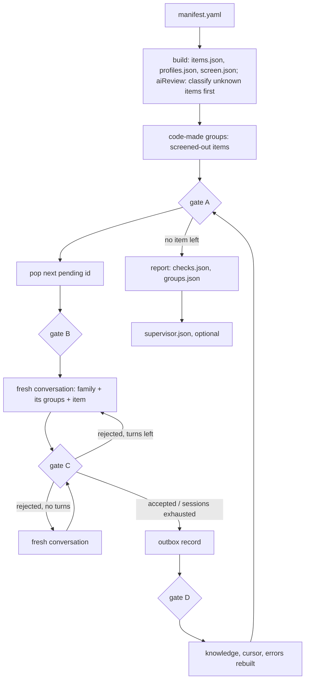

# Grouping

## Criterion

| | rule |
|---|---|
| same group | for the same input and the same call-chosen parameters, the same output: identical bytes, or, for a randomized primitive, output each decrypts or verifies for the other; the interop check measures it per pair |
| splits a group | a parameter the name or provider fixes: mode, padding, digest, `resolved` (OAEP digest, MGF1), curve, output encoding (DER/P1363), pre-hashed input, wrap or encrypt, password-based or raw key |
| does not split | a parameter the call chooses (key size, IV size, tag length: dossier `pins`), the provider, the key store, whether it runs here |
| never one group | the same output format with different bytes (SHA-256 / SHA3-256, SHA-1 / SHA-256): a substitute, not an equivalent (#56) |
| boundary | the family (`catalog/families.yaml`: engine type × key kind); items of two families are never compared |

## Diagram

## Files (`<run>/grouping/`)

| File | Written by | Holds |
|---|---|---|
| `items.json` | build | `{id, type, name, provider, family, resolved, group: null}` per item |
| `screen.json` | build | schema 3: `catalog` `{source, sha256}` the verdicts came from; `review` `{fingerprint}` only after a model review; per id: a screening verdict `{status, reason, source, canonical, keySize}` ([screening.md](screening.md)) |
| `classify/batches.json`, `classify/classified.json` | build, with aiReview | the batched evidence; the projection of the classify outbox: one answer per asked id |
| `classify/outbox/`, `classify/journal.jsonl`, `classify/errors.jsonl` | build, with aiReview | the classify commit, turns and dropped batches ([screening.md](screening.md) Model review) |
| `registry-candidates.yaml` | build, with aiReview | each `accepted` answer, for a person to confirm as a sourced catalog row |
| `profiles.json` | build | per id: keyKind and its rule, instantiates, runs, reason, default key size, key algorithm and provider, bare name, measured, prepared key sizes |
| `outbox/<fingerprint>/NNNNNN.json` | assign | one record per pending item: `decided` with the answer, or `dropped` with every problem; the commit (ai/runtime/engine); `<fingerprint>` is 12 hex of the charter and the screened-out items with their code keys (none: as before screening) |
| `outbox/active` | assign | the fingerprint of the outbox in use; records directly under `outbox/` are refused (`outbox_unversioned`) |
| `knowledge.json` | assign | the code-made groups, then the projection of the outbox: groups `{family, description, members}`, dropped ids, version |
| `cursor.json` | assign | `next` pending id, `decided` and `dropped` counts, `knowledgeVersion` |
| `journal.jsonl` | assign | one line per turn: charter, item, session, turn, status, problems, reply, message hash |
| `errors.jsonl` | assign | projection of dropped records: seq, item, label (qualified name), problems |
| `checks.json` | report | static findings with severity; counts |
| `groups.json` | report | schema 2: families, groups with members, runnable members, common key sizes, findings; items index with each item's `screen` status (null without screen.json); dropped; `interop` |
| `interop_plan.yaml` | interop-plan | schema 1: `pairs[]` `{id, group, a, b, keySize?}`; members `{type, algorithm, provider}`; every two runnable members of a group once; `keySize` the smallest common key size |
| `interop.yaml` | interop-read | cryptobenchmark's result, checked against the plan: same ids, groups and members; result agrees with directions |
| `supervisor.json` | report --supervisor | schemaVersion 2: `charter`, `prompts` {name: source path}, per family: reviewed or failed, problems, findings |
| `supervisor.journal.jsonl` | report --supervisor | one line per review turn, with `charter` |

## Code-made groups

| Rule | Value |
|---|---|
| pending | items whose screen status is not `broken` or `platform_deprecated`, a model `deprecated` included (the review runs inside build, before assign reads screen.json); only these reach the model |
| no screen.json | pending is every item and no group is code-made (runs built before screening, hand-built fixtures) |
| key | family, status and the canonical name `screen.json` recorded (key size is the call's, as in model groups); one group per key across providers |
| id | `code_` + 10 hex of the key's SHA-256: stable across runs; `_` is outside the model's id pattern, so no collision |
| description | fixed: code-made group of one algorithm, its canonical name, key size and status |
| model | never sees, joins or amends one; the supervisor does not review them; static findings, interop pairs and dossiers treat them as groups |
| groups.json | a screened-out item is in exactly one code-made group and never in a model group; a code-made group is exactly the one its key implies |
| screen change | the screened-out items and their code keys join the charter fingerprint: a change in which items are code-grouped starts a new outbox (a change among asked items' statuses does not), a reverted one resumes its old outbox; `report` on a stale outbox fails with `rerun assign` |
| resolved parameters | not in the key; a group whose members resolved differently gets `resolved_parameters_differ` |

## Answer contract

| Field | Meaning |
|---|---|
| `group` | an existing group of the item's family, or ""; exactly one of `group`, `newGroup.id`; the schema allows only "" or the id pattern |
| `newGroup.id`, `newGroup.description` | a new group when `group` is empty; id `^[a-z0-9][a-z0-9.-]{1,39}$`, minted by the model, not a family id, not an existing group; description non-empty, ≤ 400 characters |
| `amend[]` | `{group, description}`: groups of the same family, no duplicates |
| `reason` | non-empty |

## Gates

- The outbox is checked contiguous when the stage reads it.

| Gate | When | Checks |
|---|---|---|
| A | before every pop | items and profiles valid; knowledge equals the projection of the outbox; code-made groups equal the ones screen.json implies; no record for a screened-out item |
| B | after pop | item parses whole, carries no group, family and profile exist |
| C | every answer | the answer contract above; `group` and `amend` name model-made groups only; the item has no outbox record yet |
| D | after write | the record reads back equal; new knowledge validates |

## Retry

Turns, sessions and `--limit`: `docs/decisions.md`.

## Families (`catalog/families.yaml`)

| Family | Engine type | Key kind |
|---|---|---|
| `cipher.secret` | Cipher | secret |
| `cipher.pair` | Cipher | pair |
| `cipher.unknown` | Cipher | unknown |
| `signature.pair` | Signature | pair |
| `mac.secret` | Mac | secret |
| `digest.none` | MessageDigest | none |
| `keygen.none` | KeyGenerator | none |
| `keypairgen.none` | KeyPairGenerator | none |
| `agreement.peer` | KeyAgreement | peer |

## Static findings

| Kind | Severity |
|---|---|
| `resolved_parameters_differ` | error |
| `dropped` | error |
| `no_common_key_size` | warning |
| `no_runnable_member` | warning |
| `singleton` | info |
| `interop_failed` | error |
| `interop_not_checkable` | info |

## Interop

| key or label | meaning |
|---|---|
| `groups.json` `interop.status` | `checked` after interop-read; `not_run` before |
| `interop.pairs[]` | `{id, group, a, b, result, reason}`; `a`, `b` qualified names |
| `fail` | the pair is out of evidence pairs and dossier options; finding `interop_failed` |
| `not_checkable` | the pair stays; evidence and dossier carry the label; finding `interop_not_checkable` |
| `pass` | the pair stays, labelled |
| `not_planned` | checked run, pair absent from the plan (a member does not run) |
| `not_run` | no interop.yaml imported |

- A dossier option labelled anything but `pass` makes a `replace` to it declare `unverified_interop`.

- `dto/interop.py` `failed_pairs(groups)` and `pair_status(groups, a, b)` read the section; a groups.json without it is refused.
- `check/run.py` checks plan, results, the section and every `dossiers.json` option against failed pairs.
