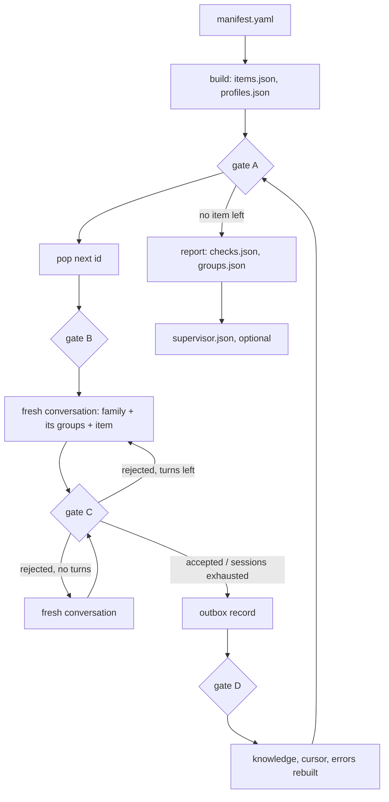

# Grouping

## Diagram

## Files (`<run>/grouping/`)

| File | Written by | Holds |
|---|---|---|
| `items.json` | build | `{id, type, name, provider, family, resolved, group: null}` per item |
| `profiles.json` | build | per id: keyKind and its rule, instantiates, runs, reason, default key size, key algorithm and provider, bare name, measured, prepared key sizes |
| `outbox/<fingerprint>/NNNNNN.json` | assign | one record per item: `decided` with the answer, or `dropped` with every problem; the commit (ai/runtime/engine); `<fingerprint>` is 12 hex of the charter |
| `outbox/active` | assign | the fingerprint of the outbox in use; records directly under `outbox/` are refused (`outbox_unversioned`) |
| `knowledge.json` | assign | projection of the outbox: groups `{family, description, members}`, dropped ids, version |
| `cursor.json` | assign | `next` id, `decided` and `dropped` counts, `knowledgeVersion` |
| `journal.jsonl` | assign | one line per turn: charter, item, session, turn, status, problems, reply, message hash |
| `errors.jsonl` | assign | projection of dropped records: seq, item, label (qualified name), problems |
| `checks.json` | report | static findings with severity; counts |
| `groups.json` | report | families, groups with members, runnable members, common key sizes, findings; items index; dropped |
| `supervisor.json` | report --supervisor | schemaVersion 2: `charter`, `prompts` {name: source path}, per family: reviewed or failed, problems, findings |
| `supervisor.journal.jsonl` | report --supervisor | one line per review turn, with `charter` |

## Answer contract

| Field | Meaning |
|---|---|
| `group` | an existing group of the item's family, or empty; exactly one of `group`, `newGroup` |
| `newGroup.id`, `newGroup.description` | a new group when `group` is empty; id `^[a-z0-9][a-z0-9.-]{1,39}$`, minted by the model, not a family id, not an existing group; description non-empty, ≤ 400 characters |
| `amend[]` | `{group, description}`: groups of the same family, no duplicates |
| `reason` | non-empty |

## Gates

- The outbox is checked contiguous when the stage reads it.

| Gate | When | Checks |
|---|---|---|
| A | before every pop | items and profiles valid; knowledge equals the projection of the outbox |
| B | after pop | item parses whole, carries no group, family and profile exist |
| C | every answer | the answer contract above; the item has no outbox record yet |
| D | after write | the record reads back equal; new knowledge validates |

## Retry

Turns, sessions and `--limit`: `docs/decisions.md`.

## Families (`catalog/families.yaml`)

| Family | Engine type | Key kind |
|---|---|---|
| `cipher.secret` | Cipher | secret |
| `cipher.pair` | Cipher | pair |
| `cipher.unknown` | Cipher | unknown |
| `signature.pair` | Signature | pair |
| `mac.secret` | Mac | secret |
| `digest.none` | MessageDigest | none |
| `keygen.none` | KeyGenerator | none |
| `keypairgen.none` | KeyPairGenerator | none |
| `agreement.peer` | KeyAgreement | peer |

## Static findings

| Kind | Severity |
|---|---|
| `resolved_parameters_differ` | error |
| `dropped` | error |
| `no_common_key_size` | warning |
| `no_runnable_member` | warning |
| `singleton` | info |
