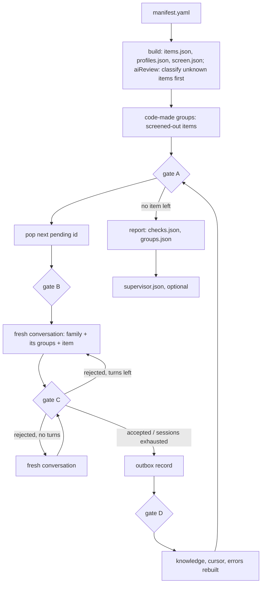

# Grouping

## Criterion

Two primitives share a group only when all three contracts match, inside one family.

| Contract | Covers | Splits a group | Evidence |
|---|---|---|---|
| input | the data and parameters the call passes, and which side supplies each one (caller-given IV, provider-generated IV) | a different side supplies a parameter; pre-hashed input; wrap or encrypt; password-based or raw key | name, attributes, `resolved` |
| key | how the key reaches the primitive: key material the application holds, or a handle to a key that lives inside the provider (keystore, TEE, StrongBox) | `app_held` against `provider_held`; `unknown` decides nothing | `keyContract` of `profiles.json` |
| output | for the same input, key and call-chosen parameters, identical bytes, or, for a randomized primitive, output each one decrypts or verifies for the other | a parameter the name or provider fixes: mode, padding, digest, `resolved` (OAEP digest, MGF1), curve, output encoding (DER/P1363); the same format with different bytes (SHA-256 / SHA3-256, SHA-1 / SHA-256: a substitute, not an equivalent, #56) | name, `resolved`; the interop check measures it per pair |

- Boundary: the family (`catalog/families.yaml`: engine type × key kind); items of two families are never compared.
- Not a contract: key size, IV size, tag length (dossier `pins`), provider identity, whether it runs on this device.

Signature: [signature.md](signature.md): what code reads per item, and which items it groups. A group is the `drop-in` class; beyond it, type, floor, availability, class: [change-classes.md](change-classes.md).

## Key contract

| Probe attributes of the service | `keyContract` | Shown to the model |
|---|---|---|
| any `SupportedKeyFormats` value, or a `SupportedKeyClasses` value under a prefix of `catalog/key-contract.yaml` (`java.security.`, `javax.crypto.`) | `app_held` | `key: application-held` |
| `SupportedKeyClasses` values, none under such a prefix | `provider_held` | `key: inside the provider` |
| neither attribute | `unknown` | no line |

- A provider registering a `KeyStore` is not evidence: a provider can register one and take raw keys.

## Diagram

## Files (`<device>/grouping/`)

| File | Written by | Holds |
|---|---|---|
| `items.json` | build | `{id, type, name, provider, family, resolved, group: null}` per item: each service of the trial and each declared transformation that ran, the names the inventory and the benchmark hold |
| `screen.json` | build | schema 5: `catalog` `{source, sha256}` the verdicts came from; `built` `{items, profiles}`: sha256 of the `items.json` and `profiles.json` written with it, so a screen.json beside another build's items is refused (`validation/screen.py` `read_checked_screen`, used by assign, report and every `read_groups`); `review` `{fingerprint}` only after a model review; per id: a screening verdict `{status, reason, source, canonical, keySize}` ([screening.md](screening.md)) |
| `classify/batches.json`, `classify/classified.json` | build, with aiReview | the batched evidence; the projection of the classify outbox: one answer per asked id |
| `classify/outbox/`, `classify/journal.jsonl`, `classify/errors.jsonl` | build, with aiReview | the classify commit, turns and dropped batches ([screening.md](screening.md) Model review) |
| `registry-candidates.yaml` | build, with aiReview | each `accepted` answer, for a person to confirm as a sourced catalog row |
| `profiles.json` | build | schema 4: per id: keyKind and its rule, instantiates, runs, reason, default key size, key algorithm and provider, bare name, measured, prepared key sizes, keyContract, signature `{components: [{name, value, status}]}`; a schema 3 folder is refused, rerun `grouping build`; build needs only the manifest's probe and trial: `runs`, `reason` and the default-run fields come from the trial (inventory's `runs` when present, itself the trial's), `measured` is null without a benchmark and `preparedKeySizes` null without `prepared.yaml`, never false or empty, so a group's `keySizes` is `[]` and `no_common_key_size` stays silent until a benchmark exists |
| `outbox/<fingerprint>/NNNNNN.json` | assign | one record per pending item: `decided` with the answer, or `dropped` with every problem, and the gateway, model and effort that answered; the commit (ai/runtime/engine); `<fingerprint>` is 12 hex of the charter, with `refresh <token>` as its inputs after `assign --refresh`; `item` is `Item.key`, `<family>\|<type>\|<name>\|<provider>`, never the id |
| `outbox/active` | assign | the fingerprint of the outbox in use; records directly under `outbox/` are refused (`outbox_unversioned`); `assign --refresh` makes a new one active, every item asked, and later runs read its token from the active charter and stay in it |
| `knowledge.json` | assign | the code-made groups, then the projection of the outbox: groups `{family, description, members}`, dropped ids, version |
| `cursor.json` | assign | `next` pending id, `decided` and `dropped` counts, `knowledgeVersion` |
| `journal.jsonl` | assign | one line per turn: charter, item, session, turn, status, problems, reply, message hash |
| `errors.jsonl` | assign | projection of dropped records: seq, item, label (qualified name), problems |
| `checks.json` | report | static findings with severity; counts |
| `groups.json` | report | schema 3: families, groups with members, runnable members, common key sizes, findings; items index with each item's `keyContract` and `screen` status (null without screen.json); dropped; with `used.json`, `notUsed`: askable items outside it with no record, left unasked and never dropped; `interop` |
| `interop_plan.yaml` | interop-plan | schema 1: `pairs[]` `{id, group, a, b, keySize?}`; members `{type, algorithm, provider}`; every two runnable members of a group once; `keySize` the smallest common key size; `notCheckable[]` `{id, group, a, b, reason}`, present when a pair crosses key contracts: never sent to the oracle, which reads only `pairs` |
| `interop.yaml` | interop-read | cryptobenchmark's result, checked against the plan: same ids, groups and members; result agrees with directions |
| `supervisor.json` | report --supervisor | schemaVersion 2: `charter`, `prompts` {name: source path}, per family: reviewed or failed, problems, findings |
| `supervisor.journal.jsonl` | report --supervisor | one line per review turn, with `charter` |

## Code-made groups

| Rule | Value |
|---|---|
| used | with `<device>/used.json` ([artifacts.md](artifacts.md#usedjson)) only the pending items it names are asked; a record outside it still places its item, so a target removed keeps its groups |
| pending | items whose screen status is not `broken` or `platform_deprecated`, a model `deprecated` included (the review runs inside build, before assign reads screen.json), and whose signature has an `unknown` component; only these reach the model |
| no screen.json | pending is every item and no group is code-made (runs built before screening, hand-built fixtures) |
| build write | everything, the classify review included, is computed first; then screen.json, profiles.json and items.json are staged as temp files and renamed in that order: a failure before the renames leaves the previous build whole, a partial rename fails screen.json's `built` digests, and screen.json first means its absence never follows a new items.json |
| key | family, status, the canonical name `screen.json` recorded, and whether the key lives inside the provider (`providerHeld`: key contract `provider_held`; `unknown` and `app_held` share a group); key size is the call's, as in model groups; one group per key across providers |
| id | `code_` + 10 hex of the key's SHA-256: stable across runs; `_` is outside the model's id pattern, so no collision |
| description | fixed: code-made group of one algorithm: its canonical name, any key size, who holds the keys, and status |
| model | never sees, joins or amends one; the supervisor does not review them; static findings, interop pairs and dossiers treat them as groups |
| groups.json | a screened-out item is in exactly one code-made group and never in a model group; a code-made group is exactly the one its key implies |
| screen change | what is screened out is no charter input, since the model never sees code groups: every change keeps the outbox. A newly screened-out item's record adds no member and it joins its code group; one no longer screened out with no record is asked, one with a record goes back to its group. Gate A and `report` recompute the code-made groups from screen.json |
| record key | ids are positional in the sorted items, so any added or removed item moves them; a record names `Item.key` and replay resolves it to today's id, so moved ids change nothing. A record whose item left (or is screened out) adds no member, and its answer still creates and amends groups, later answers may name them; a group with no member left is out of `knowledge.json` and `groups.json`, and its id stays taken for that outbox. A changed family is another key, so that item is asked again. Other facts of a name (`resolved`, the key contract) are not in the key: same name, same device id |
| outbox from positions | one naming ids, with the screened-out ids as inputs, moves once to a keyed outbox at the next assign or guide (`grouping_assign/rekey.py`), when its old charter still hashes to its name, so the prompts and the screened-out ids are unchanged; no call. Otherwise `outbox_not_rekeyed` and its items are asked. The old one stays |
| bare name | a screened-out name without mode or padding is its own canonical name, so its own code-made group, until discovery records what it resolves to |
| resolved parameters | not in the key; a group whose members resolved a different digest or MGF1, compared by canonical digest name (`SHA1` is `SHA-1`), gets `resolved_parameters_differ` |

## Answer contract

| Field | Meaning |
|---|---|
| `group` | an existing group of the item's family, or ""; exactly one of `group`, `newGroup.id`; the schema allows only "" or the id pattern |
| `newGroup.id`, `newGroup.description` | a new group when `group` is empty; id `^[a-z0-9][a-z0-9.-]{1,39}$`, minted by the model, not a family id, not an existing group; description non-empty, ≤ 400 characters |
| `amend[]` | `{group, description}`: groups of the same family, no duplicates |
| `reason` | non-empty |

## Gates

- The outbox is checked contiguous when the stage reads it. Turns, sessions and `--limit`: `docs/decisions.md`.

| Gate | When | Checks |
|---|---|---|
| A | before every pop | items and profiles valid; knowledge equals the projection of the outbox; code-made groups equal the ones screen.json implies |
| B | after pop | item parses whole, carries no group, family and profile exist |
| C | every answer | the answer contract above; `group` and `amend` name model-made groups only; a `group` no member of which knows another value for a component the item knows (a `signature:` line, the key); the item has no outbox record yet |
| D | after write | the record reads back equal; new knowledge validates |

## Families (`catalog/families.yaml`)

| Family | Engine type | Key kind |
|---|---|---|
| `cipher.secret` | Cipher | secret |
| `cipher.pair` | Cipher | pair |
| `cipher.unknown` | Cipher | unknown |
| `signature.pair` | Signature | pair |
| `mac.secret` | Mac | secret |
| `digest.none` | MessageDigest | none |
| `keygen.none` | KeyGenerator | none |
| `keypairgen.none` | KeyPairGenerator | none |
| `agreement.peer` | KeyAgreement | peer |

## Static findings

| Kind | Severity |
|---|---|
| `resolved_parameters_differ` | error |
| `key_contract_differs` | error |
| `convention_assumed` | warning |
| `dropped` | error |
| `no_common_key_size` | warning |
| `no_runnable_member` | warning |
| `singleton` | info |
| `interop_failed` | error |
| `interop_not_checkable` | info |

## Interop

| key or label | meaning |
|---|---|
| `groups.json` `interop.status` | `checked` after interop-read; `not_run` before |
| `interop.pairs[]` | `{id, group, a, b, result, reason}`; `a`, `b` qualified names |
| `fail` | the pair is out of evidence pairs and dossier options; finding `interop_failed` |
| `not_checkable` | the pair stays; evidence and dossier carry the label; finding `interop_not_checkable`; from the oracle, or from the plan for a pair across key contracts, in the section once results are imported |
| `pass` | the pair stays, labelled |
| `not_planned` | checked run, pair absent from the plan (a member does not run) |
| `not_run` | no interop.yaml imported |

- A dossier option labelled anything but `pass` makes a `replace` to it declare `unverified_interop`.

- `dto/interop.py` `failed_pairs(groups)` and `pair_status(groups, a, b)` read the section; a groups.json without it is refused.
- `check/run.py` checks plan, results, the section and every `dossiers.json` option against failed pairs.
