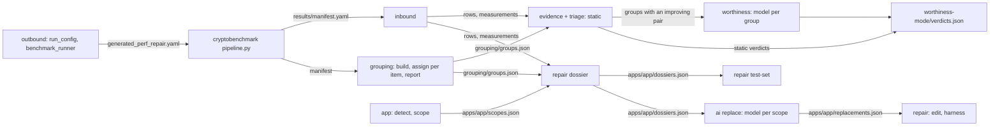

# Pipeline

## Diagram

## Stages

| Stage | Command | Reads | Writes | Model |
|---|---|---|---|---|
| outbound | `data_handler.outbound` (library) | base `global.yaml`, `config/testsets/all.yaml` default test set | `generated_perf_repair.yaml`, benchmark `results/` | no |
| inbound | `python3 -m perfrepair.data_handler.inbound --manifest <m> -o <run>` | `manifest.yaml` and its files | `rows.json`, `measurements.json`, `run_log.json` | no |
| app | `python3 -m perfrepair.app --manifest <m> --app <src> --run <run> --name <app>` | the manifest's probe, the app tree | `apps/<app>/sites.json`, `app.json`, `scopes.json` | no |
| grouping build | `python3 -m perfrepair.grouping build --manifest <m> --run <run>` | `manifest.yaml` and its files | `grouping/items.json`, `profiles.json` | no |
| grouping assign | `python3 -m perfrepair.grouping assign --run <run>` | `grouping/` | `grouping/` (`docs/grouping.md`) | one conversation per item, up to turns × sessions |
| grouping report | `python3 -m perfrepair.grouping report --run <run> [--supervisor]` | `grouping/` | `checks.json`, `groups.json`; supervisor files | supervisor: one conversation per family |
| worthiness | `python3 -m perfrepair.ai worthiness --run <run> --mode latency\|battery` | `rows.json`, `measurements.json`, `grouping/groups.json` | `worthiness-<mode>/` (evidence.json, outbox/, verdicts.json, journal.jsonl, errors.jsonl) | one per group with an improving pair |
| repair | `python3 -m perfrepair.repair dossier\|test-set\|edit\|harness --run <run> --app <app>` | `docs/repair.md` | `apps/<app>/`; test-set at `-o` | no |
| validate | `python3 -m perfrepair.validation <run>` | every artifact present | nothing | no |

- `grouping assign`, `grouping report` and `ai worthiness` accept `--agent dry-run` in place of a model.
- Inbound, app, grouping build and repair dossier, edit and harness validate before they write.
- A rerun of `grouping assign` or `ai worthiness` with the same prompts resumes after the last record of that charter's outbox; changed prompts start a new outbox, and an earlier prompt set resumes its own.
- `--prompts DIR`: `docs/decisions.md`.
