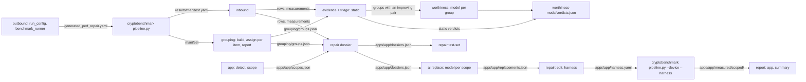

# Pipeline

## Diagram

## Stages

| Stage | Command | Reads | Writes | Model |
|---|---|---|---|---|
| outbound | `data_handler.outbound` (library) | base `global.yaml`, `config/testsets/all.yaml` default test set | `generated_perf_repair.yaml`, benchmark `results/` | no |
| inbound | `python3 -m perfrepair.data_handler.inbound --manifest <m> -o <run>` | `manifest.yaml` and its files | `rows.json`, `measurements.json`, `run_log.json` | no |
| app | `python3 -m perfrepair.app --manifest <m> --app <src> --run <run> --name <app>` | the manifest's probe, the app tree | `apps/<app>/sites.json`, `app.json`, `scopes.json` | no |
| grouping build | `python3 -m perfrepair.grouping build --manifest <m> --run <run>` | `manifest.yaml` and its files | `grouping/items.json`, `profiles.json`, `screen.json`; with `screening.aiReview` `grouping/classify/`, `registry-candidates.yaml` | with `screening.aiReview`: one conversation per batch of 10 unknown items |
| grouping assign | `python3 -m perfrepair.grouping assign --run <run>` | `grouping/` | `grouping/` (`docs/grouping.md`) | one conversation per item, up to turns × sessions |
| grouping report | `python3 -m perfrepair.grouping report --run <run> [--supervisor]` | `grouping/` | `checks.json`, `groups.json`; supervisor files | supervisor: one conversation per family |
| grouping interop-plan | `python3 -m perfrepair.grouping interop-plan --run <run>` | `grouping/groups.json` | `grouping/interop_plan.yaml` | no |
| interop check | cryptobenchmark `pipeline.py --bench\|--device --interop <plan>` | the plan, the capture | `<results>/interop/interop.yaml` | no |
| grouping interop-read | `python3 -m perfrepair.grouping interop-read --run <run> --results <interop.yaml>` | `interop.yaml`, `grouping/` | `grouping/interop.yaml`; reruns report | no |
| worthiness | `python3 -m perfrepair.ai worthiness --run <run> --mode latency\|battery` | `rows.json`, `measurements.json`, `grouping/groups.json` | `worthiness-<mode>/` (evidence.json, outbox/, verdicts.json, journal.jsonl, errors.jsonl) | one per group with an improving pair |
| repair | `python3 -m perfrepair.repair dossier\|test-set\|edit\|harness --run <run> --app <app>`; harness adds `--manifest <results>/manifest.yaml` | `docs/repair.md` | `apps/<app>/`; test-set at `-o` | no |
| device | cryptobenchmark `pipeline.py --device --harness <run>/apps/<app>/harness.yaml --results <run>/apps/<app>/measured` | `harness.yaml`, the phone | `apps/<app>/measured/` | no |
| report | `python3 -m perfrepair.report app --run <run> --app <app> [--mode]` ; `report summary --run <run>` | `apps/<app>/` | `report.json`, `report.md`; `apps/summary.json`, `summary.md` | no |
| guide | `python3 -m perfrepair guide --app <src> --name <app> --run <run> --results <results> [--device]` | the run, the app tree | app, dossier, replace, edit, harness; with `--device` measured and report | the replace step |
| validate | `python3 -m perfrepair.validation <run>` | every artifact present | nothing | no |

- `grouping build` (with `screening.aiReview`), `grouping assign`, `grouping report` and `ai worthiness` accept `--agent dry-run` in place of a model.
- Inbound, app, grouping build and repair dossier, edit and harness validate before they write.
- A command that cannot read an input, is refused by a gate, is refused at spawn or loses its model CLI prints one `error ...` line (a refused gate adds its `- problem` lines) and exits 1, never a traceback (`failure.py`); bad usage exits 2. A CLI that cannot run or fails is `claude_cli_failed`; the guide stops with `<step>_failed`.
- A rerun of `grouping assign` or `ai worthiness` with the same prompts (and, for assign, the same screened-out items) resumes after the last record of that charter's outbox; a change starts a new outbox, and an earlier set resumes its own.
- `--prompts DIR`: `docs/decisions.md`.
- `grouping assign`, `grouping report`, `ai` and `guide` fill unset flags from `perfrepair.yaml`: `docs/settings.md`; `grouping build`, `repair dossier`, `guide` and `validation` read `screening.catalog` from it (`docs/screening.md` Settings).
- The guide runs one app; inbound and grouping are run-level and must exist first. Steps, stop codes and the report: `docs/replacement.md`.
