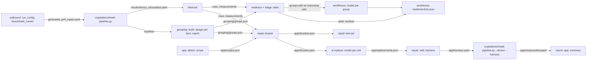

# Pipeline

## Diagram

## Stages

| Stage | Command | Reads | Writes | Model |
|---|---|---|---|---|
| outbound | `data_handler.outbound` (library) | base `global.yaml`, `config/testsets/all.yaml` default test set | `generated_perf_repair.yaml`, benchmark `<root>/<device id>/` | no |
| inbound | `python3 -m perfrepair.data_handler.inbound --device-results <device>` | `manifest.yaml` and its files | `rows.json`, `measurements.json`, `run_log.json` | no |
| app | `python3 -m perfrepair.app --device-results <device> --app <src>` | the manifest's probe, the app tree | `<app>/sites.json`, `app.json`, `scopes.json` | no |
| grouping build | `python3 -m perfrepair.grouping build --device-results <device>` | `manifest.yaml`: probe and trial; inventory, prepared and benchmark when present | `grouping/items.json`, `profiles.json`, `screen.json`; with `device.screening.aiReview` `grouping/classify/`, `registry-candidates.yaml` | with `device.screening.aiReview`: one conversation per batch of 10 unknown items |
| grouping assign | `python3 -m perfrepair.grouping assign --device-results <device> [--refresh]` | `grouping/` | `grouping/` (`docs/grouping.md`) | one conversation per item, up to turns × sessions |
| grouping report | `python3 -m perfrepair.grouping report --device-results <device> [--supervisor]` | `grouping/` | `knowledge.json`, `checks.json`, `groups.json`; supervisor files | supervisor: one conversation per family |
| grouping interop-plan | `python3 -m perfrepair.grouping interop-plan --device-results <device>` | `grouping/groups.json` | `grouping/interop_plan.yaml` | no |
| interop check | cryptobenchmark `pipeline.py --bench\|--device --interop <plan>` | the plan, the capture | `<device>/interop/interop.yaml`, added to its manifest | no |
| grouping interop-read | `python3 -m perfrepair.grouping interop-read --device-results <device> --results <interop.yaml>` | `interop.yaml`, `grouping/` | `grouping/interop.yaml`; reruns report | no |
| worthiness | `python3 -m perfrepair.ai worthiness --device-results <device> --perf-mode generic\|<keys>` | `rows.json`, `measurements.json`, `grouping/groups.json` | `worthiness-<perfMode name>/` (evidence.json, outbox/, verdicts.json, journal.jsonl, errors.jsonl) | one per group with an improving pair |
| repair | `python3 -m perfrepair.repair dossier\|test-set\|edit\|harness --device-results <device> --app <src>` | `docs/repair.md` | `<app>/`; test-set at `-o` | no |
| device | cryptobenchmark `pipeline.py --device --harness <device>/<app>/harness.yaml`, writing `measured/` beside it | `harness.yaml`, the phone | `<app>/measured/` | no |
| report | `python3 -m perfrepair.report app --device-results <device> --app <src> [--perf-mode]` ; `report summary --device-results <device>` | `<app>/` | `report.json`, `report.md`; `summary.json`, `summary.md` | no |
| guide | `python3 -m perfrepair guide [--app <src>] --device-results <device> [--device]` | the device folder, each app tree | app, dossier, replace, edit, harness per app (`apps.targets`, or `--app`), `<app>/finished.json`; with `--device` measured and report, `summary.json` | the replace step, per app |
| validate | `python3 -m perfrepair.validation --device-results <device>` | every artifact present | nothing | no |
| watch | `python3 -m perfrepair.watch <device> [--from-start]` | `log/events.jsonl`, followed | stdout | no |
| log summary | `python3 -m perfrepair.log summary <device> [--run ID \| --last] [--json]` | `log/events.jsonl` | stdout | no |

- `grouping build` (with `device.screening.aiReview`), `grouping assign`, `grouping report` and `ai worthiness` accept `--agent dry-run` in place of a model.
- Inbound, app, grouping build and repair dossier, edit and harness validate before they write.
- A command that cannot read an input, is refused by a gate, is refused at spawn or loses its model CLI prints one `error ...` line (a refused gate adds its `- problem` lines) and exits 1, never a traceback (`failure.py`); bad usage exits 2. A CLI that cannot run or fails is `claude_cli_failed`; the guide stops with `<step>_failed`.
- A rerun of `grouping assign` or `ai worthiness` with the same prompts resumes after the last record of that charter's outbox; a change starts a new outbox, and an earlier set resumes its own; `grouping assign --refresh` starts a new one on purpose. `ai replace` asks only what has no record; a decision whose dossier changed is `stale` and stops with `dossier_changed` until `ai replace --refresh` (or `guide --refresh`) asks those scopes again (`docs/decisions.md` Site replace). An item change keeps the assign outbox and asks only what has no record (`docs/grouping.md` Record key).
- `--prompts DIR`: `docs/decisions.md`.
- `grouping assign`, `grouping report`, `ai` and `guide` fill unset flags from `perfrepair.yaml`; a bad value there warns and uses the default, a bad flag errors: `docs/settings.md`; `grouping build`, `repair dossier`, `guide` and `validation` read `device.screening.catalog` from it (`docs/screening.md` Settings).
- The guide runs `--app`, else every `apps.targets` entry, the device-level steps once before them; without `--device-results` it calls probe_device() first, which makes the device folder current (below); its grouping step then reads coverage (below). Steps, stop codes and the report: `docs/replacement.md`.

## Device stage

`device/stage.py` `probe_device(root, catalog, config, on_device)`: `pipeline.py --identify` names the device (`getprop` on a phone, `RuntimeFieldsKt` on a host: the id the probe gives, without probing), then each stage is reused or rerun. It calls no model.

With `device.filterByApps`, after the targets' detect and before the benchmark, a provider the targets ship that the device lacks warns or stops, and may be built in ([used-set.md](used-set.md) Bundled providers).

Before any stage it checks the config `--identify` names against the perfMode (`device/measures.py`), so the device measures what the decisions read:

| perfMode selects | config needs | without it |
|---|---|---|
| `latency`, `throughput` | `TIME` in `run.metrics` (always there) | |
| `memAlloc` | `ALLOCATION` in `run.metrics` | stops `perf_mode_unmeasured` before any device run |
| `energy` | `run.harness.energy.capture: measured` (on a device) | logged `perf_mode_unmeasured`: a test set may capture energy per case; a case without it is `no_evidence: energyJ` |
| not `memAlloc` or not `energy` | that switch off | logged `perf_mode_extra`: device time no decision reads |

- `generic` checks nothing: it decides on what was measured and names the rest.
- The config is never rewritten: the trial runs and the real run read the same file, and a perfMode change reruns no measurement by itself. Turning a switch on or off changes `inputs.config`, so the next device stage reruns probe and benchmark.
- Checked where the guide makes the device folder (`paths.results` set, no `--device-results` or `device.id`); a named device folder is taken as measured.

| input | digest kept in | probe | benchmark | inbound | screen (grouping build) | primitives |
|---|---|---|---|---|---|---|
| `providers.bundled` | manifest `inputs.bundled`, device.yaml | reruns | reruns | reruns | reruns | reruns |
| `global.yaml` without that list, with its test set | manifest `inputs.config`, device.yaml | reruns | reruns | reruns | reruns | reruns |
| names catalog (`catalog/algorithm-names.yaml`) | device.yaml `inputs.names` | kept | kept | kept | reruns | reruns |
| screening catalog (`device.screening.catalog`) | device.yaml `inputs.screening` | kept | kept | kept | reruns | reruns |
| the manifest itself | device.yaml `manifest` (sha256) | | | reruns | reruns | reruns |
| `rows.json`, `measurements.json`, `grouping/screen.json` | device.yaml `primitives` | kept | kept | kept | kept | reruns |

- primitives writes `primitives.tsv` ([artifacts.md](artifacts.md) `primitives.tsv`), no model; `guide --refresh` reruns it alone; a device.yaml without `primitives` reruns only it.
- An unreadable `measurements.json`, an older schema included, reruns inbound.

- A stage also runs when its output is missing: no manifest (probe), no `files.benchmark` (benchmark), no `rows.json` (inbound), no `grouping/screen.json` (screen), no `primitives.tsv` (primitives); and when a stage it reads from reruns.
- Probe and benchmark are one `pipeline.py --bench` (`--device` on a phone); on a host a kept probe is passed `--discovery reuse`; a phone always probes again, logged `ran: a device benchmark probes the device it measures`.
- Without device.yaml (or unreadable), inbound and screen rerun; probe and benchmark are judged by the manifest's `inputs`, so a `pipeline.py --probe` run is kept. A fresh root runs everything.
- `device.yaml` is removed before the first stage runs and written after the last, so an interrupted call leaves no record and the next call reruns what the record would have vouched for; a failed pipeline run leaves no manifest ([results.md](../../docs/results.md)).
- The device id is the build fingerprint only, so adding a bundled provider keeps the folder; the digests, not the id, trigger the rerun.
- Each stage prints `device <stage>: reused` or `device <stage>: ran: <reason>`; a probe writing another folder than `--identify` named is `device_id_changed`.
- With `device.screening.aiReview` on, probe_device builds without the review; run `grouping build` for it.

## Used set

With `device.filterByApps` the device stage probes, detects the targets and measures only their used set: [used-set.md](used-set.md).

## Grouping knowledge

`device/coverage.py`, on every guide run, never stored: pending is every non-screened-out item in `used.json` (every one without it) with no record in the active outbox; the rest is `notUsed`, `ran: <n> of <m> items asked, <k> not used by the targets` (a `dropped` record counts: it was asked; `noRerun: false` asks it again).

| found | `device.grouping.noRerun` | model calls | `guide grouping:` |
|---|---|---|---|
| nothing pending, saved files current | true | 0 | `reused` |
| nothing pending, `knowledge.json`, `checks.json` or `groups.json` not what the outbox and items make | true | 0 | `rebuilt from the kept decisions` |
| items pending | true | one conversation per pending item | `ran: <n> of <m> items asked` |
| anything | false | every item, into a new outbox (`assign --refresh`), the old one kept | `ran: device.grouping.noRerun false, ...` |

- A named folder (`--device-results`, `device.id`) never asks on its own: items pending there stop with `missing_device_stage`; `noRerun: false` asks, it was set on purpose.
- A device-stage rerun that changes the items reaches this step the same way: new primitives are asked, removed ones leave `groups.json`, and moved ids change nothing (`docs/grouping.md` Record key).
- A capped or interrupted `noRerun: false` run restarts on the next run with it; set it back to true to finish the active outbox.
- A prompt edit alone is no coverage gap to the guide, which reads the active outbox: `grouping assign` starts the new outbox. A pending item asked after such an edit starts it too, and every item is asked there.

## Run log

`<device>/log/`: events, the status, model and bug views, pipeline transcripts: [run-log.md](run-log.md).
