# Used set

With `device.filterByApps` (default `true`) the guide hands probe_device the targets' detect, and the device stage runs in two passes, so the apps are scanned on today's probe before anything is measured:

```mermaid
flowchart LR
    P[pipeline.py --probe] --> S[screen: items, signatures, code-made groups] --> D[app step per target, static]
    D --> K[bundled: missing, suggestions, warn or stop] --> U[used.json] --> X[used-global.yaml: base + selection.exclude] --> B[pipeline.py --bench / --device]
    B --> I[inbound] --> S2[screen] --> U2[used.json again] --> T[primitives] --> G[guide grouping: pending in used.json only]
```

| step | rule |
|---|---|
| probe | `pipeline.py --probe` (`--device --probe` on a phone) when the plan reruns the probe; the benchmark run later reuses it on a host (`--discovery reuse`), a phone probes again |
| detect | each target's app step (`perfrepair.app`), no model; an app that fails here stops later at its own app step; the app step does not run twice |
| used | `used.json` ([artifacts.md](artifacts.md#usedjson)): what the sites resolve to, their groups' members, and for an item not yet grouped its candidates, so the benchmark already holds every option the model may later group it with; the model is asked after the benchmark |
| measured set | the used set joined with what device.yaml `benchmark.items` says was measured: a set grows, never shrinks, so a target removed keeps its rows |
| benchmark | reruns for the plan's reasons, or `<n> used items not measured`; a set that only shrank reruns nothing; a record without `benchmark` whose manifest is the base config's measured the whole base selection, nothing is missing |
| selection | `used-global.yaml`: the base `global.yaml`, its test set resolved, with one `selection.exclude` rule `{provider, type, name}` per device item outside the measured set; an item sharing its provider, type and canonical name with a kept one is never excluded; the base test set's includes, groups and overrides stay |
| probe digest | the manifest then carries the generated config's digest; device.yaml `benchmark.config` maps it back to the base digest, so the probe is judged by the base `global.yaml` |
| no item | no target reaches a device item: the base selection is measured, logged `device selection`, device.yaml records no `benchmark` |
| off | `false`: `used.json` removed, every askable item asked; a record with `benchmark` reruns the benchmark on the base config (`device.filterByApps off: ...`) |

- A changed set reruns the whole measured set, not only the new items: one session per comparison, since a group's members are compared with each other and the manifest holds one `benchmark.json`; cross-session drift (thermal state, frequency governor) would sit inside a ratio. The measured set is the apps' items, a small part of the device, so the rerun costs that part.
- A first run makes two pipeline runs (probe, then benchmark); later runs with the same targets make none.
- Logged: `device used` (`deviceItems`, `apps`, `sites`, `matched`, `used`, per `via`), `device selection` (`deviceItems`, `measured`, `excluded`), `device grouping` (`items` asked of, `asked`, `notUsed`).
- Each excluded item the base selection never held is one `exclude_matches_nothing` warning in `effective.yaml`: harmless, and the price of not repeating cryptobenchmark's include matching here.

## Bundled providers

A target can ship a JCA provider the device does not register. Measuring without it compares nothing the app runs, so the step after detect names each one, code only, no model (`device/bundled.py`).

| step | rule |
|---|---|
| missing | a provider a target's `app.json` `bundled` names, or a target's site resolved `not_on_device` to, neither among the probe's own providers (`origin` not `bundled`) nor shipped by a group:name in the base `providers.bundled` |
| version | per app its build files' pin (a literal coordinate, a Gradle map, a version catalog entry; several in one app: the newest); apps that differ: the newest not in the row's `badVersions`, each app's pin kept in `missing[].coordinates[].pins`; a variable or a range is no pin |
| `onMissing` | `warn`: one event and line `device bundled_missing: warn`, the run goes on; `stop`: the same event with outcome `stop`, the guide stops `bundled_missing`, listing provider, coordinates and apps, before the benchmark; the probe has run, since detect resolves against it. A stopped run resumes: a kept probe is reused |
| `fromApps` | `off`: no file, the catalog's verdicts are not logged; `suggest`: `bundled-suggestions.yaml`; `apply`: the same, and its matched rows are built in |
| matched | a catalog row of the coordinate's group:name for that provider, unblocked, at a pinned version not in its `badVersions`; every pin bad: blocked |
| blocked | the row's `blocked` reason; listed, never applied; the provider stays missing |
| unmatched | `no_catalog_row`, `no_coordinates` (a site names it, no build file ships it), `no_pinned_version`, `name_taken` (two rows register one name: the first wins); stays missing |
| apply | `bundled-global.yaml`: the base and the entries, the base's first; the measured set's config is made from it; the per-app harness builds them too, or a candidate from an applied provider would not exist there |
| rerun | device.yaml `bundled.applied` holds the entries' digest; a different set reruns the benchmark on today's probe (`the providers.bundled entries device.bundled.fromApps applies changed`). `bundled.bundled` and `bundled.config` map the manifest's digests back to the base's, as `benchmark.config` does, so the base `global.yaml` still judges the probe and an unchanged set runs nothing |

- With `device.filterByApps` only: without it nothing is detected before the benchmark, so the step does not run, and any applied set is dropped with a benchmark on the base. `--device-results` names a finished folder, so it does not run there either.
- Logged: `device bundled` (`missing`, `matched`, `blocked`, `unmatched`, `applied`), one `device bundled.<kind>` per non-empty kind with `data.items` (only `missing` with `off`), `device bundled_missing` with `data {code, items}`.
- An applied provider measures under its alias: a site naming the provider's own name still resolves `not_on_device`, and its items enter the used set only through a group.

## Evidence

API 30 emulator capture, grouping rebuilt at profiles schema 4, the apps' `sites.json` resolved on that device, grouping from empty:

| targets | used set (site, group, candidate) | runnable | asked of 46 askable | notUsed | cases of the 100 the base run measured |
|---|---|---|---|---|---|
| none: filter off | 275 | 155 | 46 | 0 | 100 |
| threema | 18 (5, 13, 0) | 14 | 0 | 46 | 36 |
| threema, deltachat, DankChat | 41 (11, 24, 6) | 30 | 8 | 38 | 70 |
| 42 apps with JCA sites (43 folders) | 62 (18, 32, 12) | 44 | 16 | 30 | 72 |

- Dry-run grouping in that order on one folder: 0, then 8, then 16 model calls in total; each new set asked only what it added; the 43-folder set was then 56 items, since an item with a record brings its group, not its candidates.
- The base run there was `testsets/quick.yaml` (20 items); against a full-device test set the measured items fall from 155 runnable to 14, 30 and 44.
- Host check (`config/global-demo.yaml`, the demo app): used set 6 of 214 items, 208 exclude rules, the 3 smoke cases measured; the second run reused every stage and made no pipeline run.
